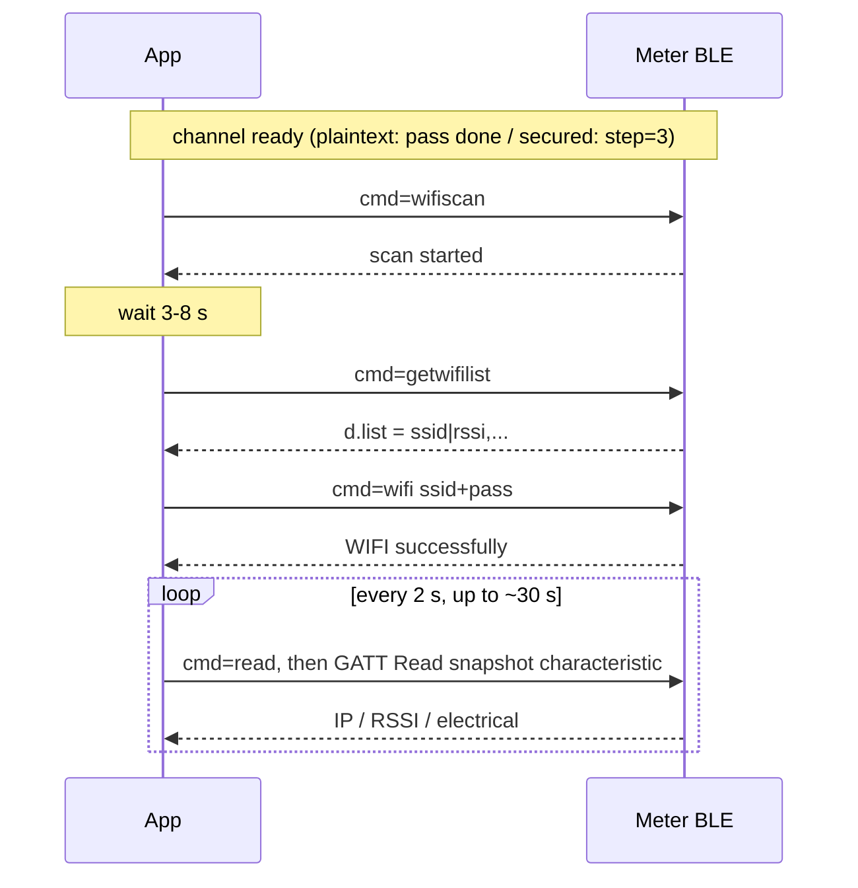

# Energy Meter BLE Business Command Reference (shared by plaintext and secured channels)

Applies to: plaintext BLE (service `A002`, Basic / Basic+) and secured BLE (service `A003`, Lite / Pro)　|　Doc version: v1.0　|　Date: 2026-10　|　Sample replies verified on an SDM01_3PN (firmware 5.1.15)

**This page is the single source of truth for the business JSON**: provisioning and device commands, snapshot fields, and business error codes. After the transport layer is removed, the business JSON of both BLE channels is **identical**, so it is maintained only here. The transport layer (UUIDs, unlock / handshake, encrypted envelope, reconnect) lives in each channel document.

| Your device | Read first (transport) | Then (business layer) |
|-------------|------------------------|-----------------------|
| Basic / Basic+ (service `A002`) | [Plaintext BLE API](../ble-plaintext/ble-plaintext-api.en.md) | this page |
| Lite / Pro (service `A003`) | [Secured BLE API](../ble-secured/ble-secured-api.en.md) | this page |

For system integrators, DIY developers and AI coding assistants. Command names, field names and device `msg` strings are kept in English exactly as the device returns them.

---

## 1. Conventions

### 1.1 Requests and responses

A request is one JSON object. `cmd` is required on every request; other fields depend on the command. Response:

| Field | Type | Meaning |
|-------|------|---------|
| `ok` | boolean | success or not |
| `msg` | string | English text, compare verbatim |
| `event` | string | normally equals the request `cmd` |
| `code` | integer | **failures only**, see [Section 6](#6-business-error-codes) |
| `d` | object | only on query commands |

Match rule: a reply is yours and successful when `resp.event == cmd` and `resp.ok == true`. Each channel has one kind of "reply that is not for your command" you must recognise: `event == "pas"` on plaintext (not unlocked) and `event == "secure"` on secured (envelope-layer failure). See each channel document for handling.

**Commands are strictly serial**: write one, wait for its reply, then write the next. Suggested timeouts: 8–15 s for most commands; 20 s for `wifi`; 25 s for `checkota` / `startota`.

### 1.2 Differences between the two channels (this is all of them)

| Item | Plaintext BLE (`A002`) | Secured BLE (`A003`) |
|------|------------------------|----------------------|
| Gate | `cmd=pass` + BLE password | `ble-crypto-*` handshake (PIN + SN) |
| Write | JSON written directly to `C303` | same JSON encrypted into `{nonce,ct,tag}` and written to `C313` |
| Reply | `C305` notification, plaintext | `C315` notification, envelope; **after decryption** identical to plaintext |
| Snapshot read | `C304` GATT Read, plaintext | `C314` GATT Read, may be an envelope; decrypt, then parse |
| Trigger snapshot | `{"cmd":"read","continue":true}` | `{"cmd":"read"}` |
| Channel-only commands | `pass`, `blepassword`, `resetauth` | `ble-crypto-ver`, `ble-crypto-reset`, `ble-crypto-jpake-round1`, `ble-crypto-jpake-round2`, `ble-crypto-session-nonce` |
| After reboot / disconnect | `pass` again | `step=2`: resume with LTK; otherwise J-PAKE again |

Apart from this table, every command, field, value and error code on this page is the same for both channels.

### 1.3 Model differences

Models do not support exactly the same commands; an unsupported command fails — some reply `unsupported`, some `unknow cmd` (1015). For example, a model without WebSocket has no `setInterval`; a model without LAN TLS has no `enablehttps`. **Clients must act on `ok` / `msg` and must not assume every device has every command.** Product identity comes from the advertised name and `TP` / `SN` in the snapshot.

---

## 2. Wi-Fi provisioning (business commands)

A meter usually has no router credentials out of the box. First complete **unlock (plaintext) or the secure handshake (secured)** for your channel, then send the **2.4 GHz** SSID and router password. Once joined, HTTP / MQTT / Modbus TCP etc. become available.

The commands below are identical on both channels (on the secured channel, wrap the JSON in the encrypted envelope first).

### 2.1 (Optional) scan for nearby Wi-Fi

```json
{"cmd":"wifiscan"}
```

Success: `msg=scan started`. If a scan is already running: `scan busy` / 1043, try again in a few seconds. Wait **3–8 seconds**, then:

```json
{"cmd":"getwifilist"}
```

```json
{"ok":true,"msg":"","event":"getwifilist","d":{"list":"OfficeWiFi|-45,Home|-72"}}
```

`d.list`: comma-separated, each item is `ssid|rssi` (integer dBm, closer to 0 is stronger), at most 10 items, sorted by strength, duplicate names keep only the strongest. If not ready: `scan not ready` / 1044, wait 2–3 s and retry.

### 2.2 Send SSID and password

```json
{"cmd":"wifi","ssid":"OfficeWiFi","pass":"router-password"}
```

| Field | Limit |
|-------|-------|
| `ssid` | Required, ≤ 64 |
| `pass` | ≤ 64; an empty string for open networks |
| `enableble` | Optional boolean. Meaningful only on firmware with secured BLE (Lite / Pro): when on, the device **keeps** the application GATT service and the service UUID in advertising after Wi-Fi is connected; when off, the device withdraws the application GATT once Wi-Fi is up. Persisted across power cycles, cleared by factory reset; omit to keep the stored value |
| `enablehttps` | Optional boolean. **Pro only**: persistently enables LAN HTTPS (443) after provisioning, effective after a restart; omit to keep the stored value; ignored on non-Pro. On Pro, when this is on, periodic UDP reports use an AES-CCM wrapped JSON (`ct` / `tag` / `counter`); otherwise UDP stays plaintext JSON |

Success: `{"ok":true,"msg":"WIFI successfully","event":"wifi"}`. This means the meter **accepted the credentials and started connecting to the router**; it does not mean an IP has been obtained yet. Missing fields: 1018; too long: 1019.

### 2.3 Confirm it is online

```json
{"cmd":"read"}
```

On the plaintext channel send `{"cmd":"read","continue":true}`. After `ok=true`, GATT Read the snapshot characteristic (`C304` on plaintext; `C314` on secured, decrypt first) and look at `IP`:

| `IP` | Meaning |
|------|---------|
| An IPv4 address such as `192.168.x.x` | **Online, provisioning succeeded** |
| `-1` | Just sent, state unknown |
| `0` | Idle |
| `1` | SSID not found (wrong name, not 2.4 GHz, too far away) |
| `3` | Associated (normally becomes an IPv4 address very soon) |
| `4` / `5` / `6` | Failed / lost / disconnected (a wrong password is the most common cause) |

After provisioning, read every 2 s for about 30 s at most.



### 2.4 Suggested UI copy

Title "Connect meter to Wi-Fi"; SSID field "2.4 GHz network name"; password field "Router password (not the BLE password / PIN)"; primary button "Send to meter"; secondary button "Scan nearby Wi-Fi" (only after unlock / secure handshake).

---

## 3. Command reference

Send once the channel is ready (plaintext: `pass` done; secured: `step=3`). `event` equals `cmd` by default.

### 3.1 Device control

| cmd | Request | Success `msg` | Note |
|-----|---------|---------------|------|
| `restart` | `{"cmd":"restart"}` | `restart received` | GATT then drops; reconnect per [plaintext 4.5](../ble-plaintext/ble-plaintext-api.en.md#45-disconnect-and-reconnect) / [secured 4.10](../ble-secured/ble-secured-api.en.md#410-disconnect--reconnect) |
| `location` | `{"cmd":"location"}` | `location received` | The LED blinks at about 4 Hz for 15 s so you can find the meter on site |
| `zero` | `{"cmd":"zero"}` | `zero received` | **Clears accumulated energy, cannot be undone** |
| `reset` | `{"cmd":"reset"}` | `reset received` | Clears the configuration and restarts |
| `deviceName` | `{"cmd":"deviceName","name":"RoomMeter01"}` | `deviceName yes` | `name` ≤ 30; longer returns 1027 |
| `commonmode` | `{"cmd":"commonmode","value":0}` | `commonmode yes` | Sets the message reporting format: `0` = BT format, `1` = generic format |

### 3.2 Queries

**`model`**, configuration snapshot:

```json
{"cmd":"model","type":1}
```

```json
{"ok":true,"msg":"","event":"model","d":{"WN":"OfficeWiFi","WPN":"EnergySensor-SDM01_3PN_01-10304B0D7760","MH":"","MF":false,"MP":0,"MC":"","MI":5000,"MS":false,"LSM":0,"UI":5000,"MAD":"5 / 9600 / N81"}}
```

See [Appendix C](#appendix-c-model-short-keys) for the short keys. The set of keys differs slightly between models: handle them by "does the key exist".

**`getFunctionMap`**, enabled communication features:

```json
{"cmd":"getFunctionMap"}
```

```json
{"ok":true,"msg":"","event":"getFunctionMap","d":{"functionMap":32896}}
```

`32896` = `32768 + 128`, meaning Modbus TCP (bit 15) and HTTP (bit 7) are enabled. See [Appendix B](#appendix-b-functionmap-bits) for the bits.

**`mqttdata`**:

```json
{"ok":true,"msg":"","event":"mqttdata","d":{"TP":"SDM01_3PN/10304B0D7760/data","TC":"SDM01_3PN/10304B0D7760/cmd","TR":"SDM01_3PN/10304B0D7760/cdata","TM":"SDM01_3PN/10304B0D7760/mdata","MU":"","MPS":""}}
```

`TP/TC/TR/TM` are the four topics (the defaults contain the model and serial number); `MU` / `MPS` are the MQTT credentials. The response above is from a real device with MQTT not enabled, and **it has no `MF` key**; only devices with MQTT enabled add `MF`, for example `"MF":0`. Handle it by "does the key exist".

`MF` (when MQTT is enabled): `-4` timeout, `-3` connection lost, `-2` TCP/TLS failure, `-1` disconnected, `0` connected, `1` protocol rejected, `2` ClientId rejected, `3` broker unavailable, `4` bad credentials, `5` not authorized. Some firmware returns `-1` when MQTT is not enabled, others omit `MF` entirely, so also check whether MQTT has been configured. **Note: `MF` in `model` is a boolean; do not mix it up with the numeric status code here.**

**`udpdata`**:

```json
{"ok":true,"msg":"","event":"udpdata","d":{"udp_data":[]}}
{"ok":true,"msg":"","event":"udpdata","d":{"udp_data":[{"ip":"192.168.1.20","port":"8888"}]}}
```

### 3.3 LAN protocol switches

| cmd | Purpose | Success `msg` |
|-----|---------|---------------|
| `enablehttp` | Plain HTTP on `:80`. `enable` omitted or `true` = on, `false` = off | `http yes` / `http off` |
| `enablewebsocket` | WebSocket; optional `enableTLS` | `websocket yes` |
| `enablemodbustcp` | Modbus TCP | `modbus tcp yes` |
| `enabletls` | TLS feature bit | `tls yes` |
| `enablehttps` | LAN HTTPS (some models only) | `https yes` / `https off` |

```json
{"cmd":"enablehttp","enable":true}
```

These commands **only save the configuration**. They do not drop BLE and do not restart the device by themselves. The device has limited memory, and toggling communication channels repeatedly fragments it, so:

- **After changing the switches, send a single `{"cmd":"restart"}`** and reconnect per [plaintext 4.5](../ble-plaintext/ble-plaintext-api.en.md#45-disconnect-and-reconnect) / [secured 4.10](../ble-secured/ble-secured-api.en.md#410-disconnect--reconnect);
- After `enablehttp` is turned on, `:80` only starts listening after a restart; turning it off stops it immediately;
- Do not toggle channels frequently at run time, and do not enable several memory-hungry channels at once (see `functionMap error` below).

Writing `{"cmd":"functionMap","value":<integer>}` directly **overwrites the whole bitmap**, and the number of LAN channels that can be on at the same time is limited; exceeding it returns `functionMap error` (1014). Normal apps should use the `enable*` commands above and not write `functionMap` directly.

### 3.4 MQTT

```json
{"cmd":"mqtt","data":"broker.example.com|dev01|1|8883|5|user|pwd"}
```

`data` = `host|clientid|ssl|port|interval|username|password`. `ssl`: `1` TLS, `0` plaintext. `interval` is in **seconds**; after saving it appears in `model` as `MI` in **milliseconds**. Success: `MQTT successfully`.

- `mqtt`: saves only, **no restart**.
- `mqtr`: same parameters, saves and then **restarts**.
- Empty `data`: `Error mqtt data empty!` / 1021.

```json
{"cmd":"topic1","topic_post":"dev/up","topic_set":"dev/down"}
{"cmd":"topic2","topic_response":"dev/resp","topic_metadata":"dev/meta"}
```

To use your own CA certificate for MQTT: send `cafilestart` first, then `cafiledata` in several chunks. You can skip this if you only do Wi-Fi provisioning.

### 3.5 Modbus 485, UDP, OTA

```json
{"cmd":"modbus","baud":9600,"parityStop":0,"address":1}
```

Success: `modbus yes`. `parityStop`: `0` = N81, `1` = E81, `2` = O81, `3` = N82 (no parity, 2 stop bits). The current 485 settings can be read from `model.d.MAD`, for example `"5 / 9600 / N81"` (address / baud rate / parity).

**UDP targets** (at most 5):

```json
{"cmd":"udp","IpAddress":"192.168.1.100","localUdpPort":9000,"Frequency":5}
```

- `IpAddress`: target IP; `localUdpPort`: target port (that is the field name, but it means the **remote** port).
- `Frequency`: optional, report period in **seconds**; the device converts it to milliseconds (`UI` in `model`) with a lower limit of 100 ms; if omitted the current period is kept. The period is global and shared by all UDP targets.
- Success: `UDP successfully`. Sending the same IP + port again only updates the period. **Adding a target automatically turns on the UDP feature bit** (functionMap bit 13).
- If the IP is empty or the port is invalid, the device also returns `UDP full` / 1024, so do not read it literally as "full".
- Delete: `{"cmd":"deleteudp","IpAddress":"192.168.1.100","localUdpPort":9000}`, success `UDP deleted`; if it does not exist `UDP not found` / 1025. Deleting a target does **not** turn off the UDP feature bit.
- List: `udpdata`, see [3.2](#32-queries). Targets are in `d.udp_data` as `{"ip":"…","port":"…"}`; with no targets it is an empty array.

**OTA upgrade**:

| cmd | Request | Description |
|-----|---------|-------------|
| `checkota` | `{"cmd":"checkota"}` | Asks the server whether new firmware exists, without downloading. The device has to contact the server, so **it took about 8 seconds to answer in testing**; allow 25 s |
| `otaprogress` | `{"cmd":"otaprogress"}` | Query progress, read-only |
| `startota` | `{"cmd":"startota"}` or with `url` / `reboot` | Starts the upgrade and returns immediately; poll progress with `otaprogress` |

`checkota` response (`otastatus`: `200` update available, `404` already up to date or version info invalid, `199` not enough device memory, anything else is a network / server error code):

```json
{"ok":true,"msg":"","event":"checkota","d":{"otastatus":404}}
```

`otaprogress` response (real device, no upgrade running):

```json
{"ok":true,"msg":"","event":"otaprogress","d":{"otaprogress":0,"otastatus":-1,"otastatusText":"idle","reboot":1,"version":"5.1.15"}}
```

| `otastatus` | `otastatusText` | Meaning |
|-------------|-----------------|---------|
| -1 | idle | No upgrade task (default after power-up) |
| 0 | success | Upgrade finished; it only counts as success when `otaprogress` is 100 |
| 1 | write length insufficient | Firmware data incomplete |
| 2 | verify failed | Firmware verification failed |
| 3 | set boot partition failed | Switching boot partition failed |
| 4 | ota begin failed | Upgrade initialization failed |
| 5 | no ota partition available | No usable upgrade partition |
| 6 | ota running | Upgrade in progress |
| other | — | Network / HTTP error code during download |

`startota`: `url` is optional and defaults to the address determined by `checkota`; `reboot` is optional (`true` / `false` / `1` / `0`, default `1`); with `0` the device does not restart after the upgrade and the client has to send `restart` itself. Success response: `{"ok":true,"msg":"startota yes","event":"startota"}`. The upgrade runs in the background on the device; do not cut the power while it runs.

**WebSocket push interval**:

| cmd | Description |
|-----|-------------|
| `setInterval` / `getInterval` | Control **only** the WebSocket push interval (milliseconds, 100–86400000, usually 5000 by default); they do **not** change MQTT `MI` or UDP `UI`. Unsupported models fail: some answer `unsupported`, others (such as SDM01_3PN) answer `unknow cmd` / 1015. Treat both as a failure |

---

## 4. Command index (for AI to scan)

Business commands (both channels):

`read`, `wifi`, `wifiscan`, `getwifilist`, `restart`, `location`, `zero`, `reset`, `deviceName`, `commonmode`, `model`, `getFunctionMap`, `functionMap`, `enablehttp`, `enablehttps`, `enablewebsocket`, `enablemodbustcp`, `enabletls`, `setInterval`, `getInterval`, `mqtt`, `mqtr`, `topic1`, `topic2`, `mqttdata`, `cafilestart`, `cafiledata`, `modbus`, `getModbusTlsMuxSetupStatus`, `udp`, `deleteudp`, `udpdata`, `checkota`, `otaprogress`, `startota`

Channel-only commands: plaintext `pass`, `blepassword`, `resetauth` (see the [plaintext doc](../ble-plaintext/ble-plaintext-api.en.md#6-command-reference)); secured `ble-crypto-ver`, `ble-crypto-reset`, `ble-crypto-jpake-round1`, `ble-crypto-jpake-round2`, `ble-crypto-session-nonce` (see the [secured doc](../ble-secured/ble-secured-api.en.md#49-plaintext-handshake-commands)).

Do not use command or field names that are not listed here.

---

## 5. Snapshot read: IP and electrical readings

The electrical / IP snapshot is obtained with a **GATT Read** (`C304` on plaintext, `C314` on secured); do not mix it with notifications. Send the `read` command first (see [1.2](#12-differences-between-the-two-channels-this-is-all-of-them)), then Read after the `ready` reply.

On the secured channel the bytes read back may be an envelope `{nonce,ct,tag}`; the JSON below appears **after decryption**. On the plaintext channel, reading before unlock returns `Please unlock` (1002).

Most numeric readings are **decimal strings**, not JSON numbers; convert them yourself.

### 5.1 Common fields

| Key | Type | Meaning |
|-----|------|---------|
| `IP` | string | Online = IPv4; not online = a status code, see [2.3](#23-confirm-it-is-online) |
| `RSSI` | int | Downlink signal strength from router to meter (dBm) |
| `FW` | string | Firmware version |
| `SN` | string | Serial number |
| `TP` | int | Product type code |

### 5.2 Electrical keys: parse by "does the key exist"

**Do not hard-code single-phase / three-phase from `TP`.** If `VX` / `VY` / `VZ` exist, parse as multi-phase; if `V` exists, parse as single-phase. A missing key means the model does not have that item.

| Form | Keys |
|------|------|
| Single-phase | `V` `I` `P` `PF` `F` `FE` `RE` |
| Three-phase | `VX VY VZ`, `IX IY IZ`, `PX PY PZ`, `PFX PFY PFZ`, `F`, `FEX FEY FEZ`, `REX REY REZ` |
| Two-channel | Same as three-phase but only with suffixes `X` / `Y` (no `Z`) |

`TP` reference: `1` / `2` single-phase, `3` / `4` three-phase, `5` two-channel, `8` / `9` new platform (still use the single-phase or three-phase key names above).

Meaning: `V` voltage, `I` current, `P` power, `PF` power factor, `F` frequency, `FE` forward energy, `RE` reverse energy. A trailing `X/Y/Z` denotes the phase or channel.

Units: voltage **V**, current **A**, power **kW** (not W), energy **kWh**, frequency **Hz**. The strings contain digits only, no unit. Approximate decimals: voltage 1, current / power 3, power factor / frequency / energy 2.

Single-phase read-back shape (values are illustrative):

```json
{"IP":"192.168.3.60","RSSI":-58,"FW":"5.1.15","SN":"10304B0D0001","TP":2,"V":"230.1","I":"1.234","P":"0.280","PF":"0.98","F":"50.00","FE":"12.34","RE":"0.01"}
```

Three-phase read-back (real SDM01_3PN, `TP` is 4):

```json
{"IP":"192.168.3.75","RSSI":-56,"FW":"5.1.15","SN":"10304B0D7760","TP":4,"VX":"225.8","VY":"225.9","VZ":"226.0","IX":"7.207","IY":"7.191","IZ":"7.212","PX":"1.627","PY":"1.625","PZ":"1.630","PFX":"1.00","PFY":"1.00","PFZ":"0.99","F":"50.00","FEX":"0.21","REX":"0.00","FEY":"0.22","REY":"0.00","FEZ":"0.17","REZ":"0.00"}
```

The values are consistent with each other: about 226 V, about 7.2 A per phase and about 1.63 kW per phase (226 × 7.2 ≈ 1.63 kW), which you can use as a unit sanity check.

---

## 6. Business error codes

On failure the notification or the read characteristic is JSON: `ok=false`, an integer `code` and an English `msg`. **Success packets have no `code`.**

For configuration failures the BLE `code` = **1000 + sub-code**, so some numbers overlap with fixed codes (especially 1002–1005). **Rely on `msg`; use `code` only as a hint.**

| code | `msg` | Meaning / action |
|------|-------|------------------|
| 1014 | functionMap error | Illegal or over-limit combination of communication features |
| 1015 | unknow cmd | Unknown command, or this model does not have it (the `msg` is spelled this way, compare it verbatim) |
| 1018 | Error wifi ssid/pass required! | SSID or password missing |
| 1019 | Error wifi length! | Wi-Fi parameter too long |
| 1021 | Error mqtt data empty! | MQTT `data` is empty |
| 1024 | UDP full | UDP target list full, or the IP / port is invalid |
| 1025 | UDP not found | The UDP target to delete does not exist |
| 1027 | Error name length! | Display name too long |
| 1043 | scan busy | A scan is in progress, try later |
| 1044 | scan not ready | Result not ready, wait 2–3 s and fetch again |

Channel gate / handshake / envelope errors are in [plaintext doc Section 8](../ble-plaintext/ble-plaintext-api.en.md#8-error-codes) and [secured doc Section 8](../ble-secured/ble-secured-api.en.md#8-error-codes). Less common codes: [Appendix A](#appendix-a-less-common-error-codes).

### 6.1 Cases without a `code`

| Symptom | Action |
|---------|--------|
| `msg` is `illegal cmd` / `unsupported` | this model does not have the command |
| a notification is not valid JSON | log and ignore, do not crash; suspect a too-small MTU |

---

## Appendix A Less common error codes

The BLE `code` = 1000 + sub-code. Most integrators will not need these.

| code | `msg` | Meaning |
|------|-------|---------|
| 1006 | null | Not the matching model, no such data |
| 1016 | Timer not found | Timer does not exist |
| 1017 | Invalid timer | Invalid timer parameters |
| 1020 | Error wifi reset in progress | Wi-Fi reset conflict |
| 1022 | Error length! | MQTT or other field too long |
| 1023 | cafile error | Certificate flow error |
| 1028 | mda format error | Register extension format error |
| 1029 | mda failed | Register extension failed |
| 1030 | minvert data format error | Invert configuration format error |
| 1031 | minvert save failed | Saving invert configuration failed |
| 1032 | minvert data length error | Invert configuration length error |
| 1033 | minvert data error | Invert configuration data error |
| 1034 | minvert missing data | Invert configuration data missing |
| 1035 | bleota no data | BLE OTA: no data |
| 1036 | bleota err param | BLE OTA: invalid parameter |
| 1037 | bleota err state | BLE OTA: wrong state |
| 1038 | bleota err seq | Packet sequence not continuous |
| 1039 | bleota err crc | CRC failure |
| 1040 | bleota err write | Partition write failed |
| 1041 | bleota err size | Firmware too large |
| 1042 | bleota err unknown | BLE OTA: unknown error |

## Appendix B functionMap bits

`d.functionMap` is a 16-bit integer. Bit `n` is on when `functionMap & (1<<n)` is non-zero.

| Bit | Feature |
|-----|---------|
| 15 | Modbus TCP |
| 14 | TLS (usually together with Modbus) |
| 13 | UDP |
| 11 | WebSocket |
| 10 | WebSocket TLS |
| 9 | MQTT |
| 7 | HTTP `:80` |
| 5 | LoRaWAN |
| others | Reserved, ignore them |

Examples: `128` = HTTP only; HTTP + MQTT = `128 + 512 = 640`; `32896` = Modbus TCP + HTTP.

## Appendix C model short keys

| Key | Meaning |
|-----|---------|
| `WN` | Wi-Fi SSID |
| `WPN` | Device display name |
| `MH` | MQTT host (empty = not configured) |
| `MF` | Whether MQTT is connected (**boolean**) |
| `MP` | MQTT port (0 = not configured) |
| `MC` | MQTT ClientId |
| `MI` | MQTT report interval, in **milliseconds** |
| `MS` | Whether MQTT uses TLS |
| `LSM` | Weak-signal mode, 0 / 1 |
| `UI` | UDP report interval, in milliseconds |
| `WI` | WebSocket push interval, in milliseconds (models without WebSocket do not have this key) |
| `TS` | Modbus TLS multiplexing state 0–5 (some models only) |
| `MAD` | 485: `address / baud rate / parity`, e.g. `5 / 9600 / N81` |
