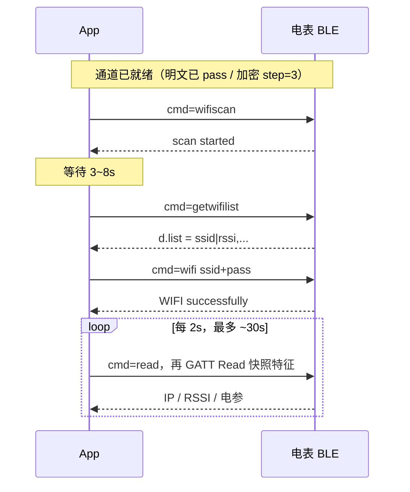

# 电表 BLE 业务命令参考（明文 / 加密通道共用）

适用：明文 BLE（服务 `A002`，Basic / Basic+）与加密 BLE（服务 `A003`，Lite / Pro）　|　文档版本：v1.0　|　日期：2026-10　|　示例应答已在 SDM01_3PN（固件 5.1.15）上实机校对

**本页是业务 JSON 的唯一说明**：配网命令、设备命令、读快照字段、业务错误码。两种 BLE 通道在"解开传输层之后"的业务 JSON **完全一致**，所以只在这里维护一份；传输层（UUID、解锁 / 握手、加密信封、重连）见各通道文档。

| 你的设备 | 先读（传输层） | 再读（业务层） |
|----------|----------------|----------------|
| Basic / Basic+（服务 `A002`） | [明文 BLE 接口说明](../ble-plaintext/ble-plaintext-api.zh-CN.md) | 本页 |
| Lite / Pro（服务 `A003`） | [加密 BLE 接口说明](../ble-secured/ble-secured-api.zh-CN.md) | 本页 |

本文面向系统集成商、DIY 开发者和 AI 编程助手。命令名、字段名、设备 `msg` 保持英文原样。

---

## 1. 约定

### 1.1 请求与应答

请求是一个 JSON 对象，`cmd` 每条必填，其余字段见各命令。应答：

| 字段 | 类型 | 说明 |
|------|------|------|
| `ok` | boolean | 是否成功 |
| `msg` | string | 英文原文，按原文比对 |
| `event` | string | 通常等于请求的 `cmd` |
| `code` | integer | **仅失败时出现**，见 [第 6 节](#6-业务错误码) |
| `d` | object | 仅查询类命令带数据 |

匹配规则：`resp.event == cmd` 且 `resp.ok == true` 才算成功。两个通道各有一种"不是你这条命令的应答"需要识别：明文通道的 `event == "pas"`（未解锁），加密通道的 `event == "secure"`（信封层失败）。处理方式见各通道文档。

**命令必须串行**：写一条 → 等对应应答 → 再写下一条。建议超时：一般命令 8～15 秒；`wifi` 20 秒；`checkota` / `startota` 25 秒。

### 1.2 两个通道的差异（只有这些）

| 项 | 明文 BLE（`A002`） | 加密 BLE（`A003`） |
|----|--------------------|--------------------|
| 门禁 | `cmd=pass` + BLE 密码 | `ble-crypto-*` 握手（PIN + SN） |
| 写命令 | JSON 直接写 `C303` | 同一 JSON 加密成 `{nonce,ct,tag}` 写 `C313` |
| 应答 | `C305` 通知，明文 | `C315` 通知，信封；**解密后**与明文通道相同 |
| 读快照 | `C304` GATT Read，明文 | `C314` GATT Read，可能是信封，解密后解析 |
| 触发读快照 | `{"cmd":"read","continue":true}` | `{"cmd":"read"}` |
| 通道专有命令 | `pass`、`blepassword`、`resetauth` | `ble-crypto-ver`、`ble-crypto-reset`、`ble-crypto-jpake-round1`、`ble-crypto-jpake-round2`、`ble-crypto-session-nonce` |
| 重启 / 断开后 | 重新 `pass` | `step=2` 用 LTK 恢复，否则重新 J-PAKE |

除上表外，本页的所有命令、字段、取值、错误码对两个通道一律相同。

### 1.3 型号差异

不同型号支持的命令不完全一致，不支持时设备返回失败：有的回 `unsupported`，有的回 `unknow cmd`（1015）。例如：没有 WebSocket 的型号没有 `setInterval`；没有局域网 TLS 的型号没有 `enablehttps`。**客户端必须按 `ok` / `msg` 处理，不要假设每台设备都有全部命令。** 产品身份以广播名和读快照里的 `TP`、`SN` 为准。

---

## 2. Wi-Fi 配网（业务命令）

电表出厂时通常还没有路由器账号。先按所用通道完成**解锁（明文）或安全握手（加密）**，再下发 **2.4 GHz** 的 SSID 和路由器密码。成功后电表加入局域网，HTTP / MQTT / Modbus TCP 等才可用。

以下命令对两个通道相同（加密通道请先把 JSON 套进加密信封）。

### 2.1 （可选）扫描附近 Wi-Fi

```json
{"cmd":"wifiscan"}
```

成功：`msg=scan started`。正在扫：`scan busy` / 1043，几秒后再试。等 **3～8 秒** 后：

```json
{"cmd":"getwifilist"}
```

```json
{"ok":true,"msg":"","event":"getwifilist","d":{"list":"OfficeWiFi|-45,Home|-72"}}
```

`d.list`：逗号分隔，每条 `ssid|rssi`（整数 dBm，越接近 0 越强），最多 10 条，按强度排序，同名只留最强。未好：`scan not ready` / 1044，等 2～3 秒重试。

### 2.2 下发 SSID 与密码

```json
{"cmd":"wifi","ssid":"OfficeWiFi","pass":"router-password"}
```

| 字段 | 限制 |
|------|------|
| `ssid` | 必填，≤ 64 |
| `pass` | ≤ 64；开放网络可传空字符串 |
| `enableble` | 可选，布尔。仅带加密 BLE 的固件（Lite / Pro）有意义：开启后，配网成功、Wi-Fi 已连接后设备**仍保留**应用 GATT 与广播里的服务 UUID；不开启时，Wi-Fi 连上后设备通常会收起应用 GATT 和广播里的服务 UUID。掉电保存，恢复出厂清除；省略则不改变已存值 |
| `enablehttps` | 可选，布尔。仅 **Pro**：配网后持久化开启局域网 HTTPS（443），重启后生效；省略则不改变已存值；非 Pro 忽略。Pro 上此开关为开时，周期 UDP 上报会改用 AES-CCM 封装的 JSON（`ct` / `tag` / `counter`），否则 UDP 为明文 JSON |

成功：`{"ok":true,"msg":"WIFI successfully","event":"wifi"}`。这表示电表**已接受并开始连路由器**，不等于已经拿到 IP。缺字段 1018，过长 1019。

### 2.3 确认上网

```json
{"cmd":"read"}
```

明文通道请写 `{"cmd":"read","continue":true}`。应答 `ok=true` 后 GATT Read 快照特征（明文 `C304`；加密 `C314`，须先解密），看 `IP`：

| `IP` | 含义 |
|------|------|
| `192.168.x.x` 等 IPv4 | **已上网，配网成功** |
| `-1` | 刚下发，未知 |
| `0` | 空闲 |
| `1` | 找不到 SSID（名称错、不是 2.4G、距离远） |
| `3` | 已关联（通常很快变成 IPv4） |
| `4` / `5` / `6` | 失败 / 丢失 / 断开（密码错最常见） |

配网后每 2 秒读一次，最多约 30 秒。



### 2.4 界面文案建议

标题「连接电表 Wi-Fi」；SSID 栏「2.4 GHz 网络名称」；密码栏「路由器密码（不是 BLE 密码 / PIN）」；主按钮「发送到电表」；次按钮「扫描附近 Wi-Fi」（须已解锁 / 已建链）。

---

## 3. 命令参考

通道已就绪（明文：已 `pass`；加密：已 `step=3`）后发送。`event` 默认等于 `cmd`。

### 3.1 设备控制

| cmd | 请求 | 成功 `msg` | 说明 |
|-----|------|-----------|------|
| `restart` | `{"cmd":"restart"}` | `restart received` | 随后 GATT 断开，按 [明文 4.5](../ble-plaintext/ble-plaintext-api.zh-CN.md#45-断开与重连) / [加密 4.10](../ble-secured/ble-secured-api.zh-CN.md#410-断开与重连) 重连 |
| `location` | `{"cmd":"location"}` | `location received` | 指示灯约 4 Hz 闪 15 秒，用来现场找表 |
| `zero` | `{"cmd":"zero"}` | `zero received` | **电能清零，不可恢复** |
| `reset` | `{"cmd":"reset"}` | `reset received` | 清空配置并重启 |
| `deviceName` | `{"cmd":"deviceName","name":"RoomMeter01"}` | `deviceName yes` | `name` ≤ 30；过长 1027 |
| `commonmode` | `{"cmd":"commonmode","value":0}` | `commonmode yes` | 设置消息上报格式：`0` = BT 格式，`1` = 通用格式 |

### 3.2 查询

**`model`** 配置快照：

```json
{"cmd":"model","type":1}
```

```json
{"ok":true,"msg":"","event":"model","d":{"WN":"OfficeWiFi","WPN":"EnergySensor-SDM01_3PN_01-10304B0D7760","MH":"","MF":false,"MP":0,"MC":"","MI":5000,"MS":false,"LSM":0,"UI":5000,"MAD":"5 / 9600 / N81"}}
```

短键含义见 [附录 C](#附录-c-model-短键)。不同型号键集合略有差别，按"键是否存在"处理。

**`getFunctionMap`** 已开启的通讯功能：

```json
{"cmd":"getFunctionMap"}
```

```json
{"ok":true,"msg":"","event":"getFunctionMap","d":{"functionMap":32896}}
```

`32896` = `32768 + 128`，即 Modbus TCP（bit15）与 HTTP（bit7）已开启。位含义见 [附录 B](#附录-b-functionmap-位)。

**`mqttdata`**：

```json
{"ok":true,"msg":"","event":"mqttdata","d":{"TP":"SDM01_3PN/10304B0D7760/data","TC":"SDM01_3PN/10304B0D7760/cmd","TR":"SDM01_3PN/10304B0D7760/cdata","TM":"SDM01_3PN/10304B0D7760/mdata","MU":"","MPS":""}}
```

`TP/TC/TR/TM` 为四个主题（默认值带型号和序列号），`MU` / `MPS` 为 MQTT 账号。上面是未启用 MQTT 的真机应答，**此时没有 `MF` 键**；已启用 MQTT 的设备才会多出 `MF`，如 `"MF":0`。请按"键是否存在"处理。

`MF`（MQTT 已启用时）：`-4` 超时，`-3` 连接丢失，`-2` TCP/TLS 失败，`-1` 断开，`0` 已连接，`1` 协议被拒，`2` ClientId 被拒，`3` Broker 不可用，`4` 账号错误，`5` 未授权。部分固件在未启用 MQTT 时返回 `-1`，部分直接不带 `MF`，需结合是否配置过 MQTT 判断。**注意：`model` 里的 `MF` 是布尔值，不要和这里的数字状态码混用。**

**`udpdata`**：

```json
{"ok":true,"msg":"","event":"udpdata","d":{"udp_data":[]}}
{"ok":true,"msg":"","event":"udpdata","d":{"udp_data":[{"ip":"192.168.1.20","port":"8888"}]}}
```

### 3.3 通讯开关

| cmd | 作用 | 成功 `msg` |
|-----|------|-----------|
| `enablehttp` | 明文 HTTP `:80`。`enable` 省略或 `true` 开，`false` 关 | `http yes` / `http off` |
| `enablewebsocket` | WebSocket；可选 `enableTLS` | `websocket yes` |
| `enablemodbustcp` | Modbus TCP | `modbus tcp yes` |
| `enabletls` | TLS 功能位 | `tls yes` |
| `enablehttps` | 局域网 HTTPS（仅部分型号） | `https yes` / `https off` |

```json
{"cmd":"enablehttp","enable":true}
```

这几条命令**只保存配置**，不会断开 BLE，也不会自动重启。设备内存有限，反复开关通讯通道会造成内存碎片，所以：

- **改完通讯开关后，统一发一次 `{"cmd":"restart"}`**，再按 [明文 4.5](../ble-plaintext/ble-plaintext-api.zh-CN.md#45-断开与重连) / [加密 4.10](../ble-secured/ble-secured-api.zh-CN.md#410-断开与重连) 重连；
- `enablehttp` 开启后必须重启才会监听 `:80`；关闭则立即停止；
- 不要在运行中频繁开关，也不要同时开启多个占内存的通道（见下方 `functionMap error`）。

直接写 `{"cmd":"functionMap","value":整数}` 会**覆盖整张位图**，且同时开启的局域网通道有上限，超限返回 `functionMap error`（1014）。普通 App 请用上面的 `enable*`，不要直接写 `functionMap`。

### 3.4 MQTT

```json
{"cmd":"mqtt","data":"broker.example.com|dev01|1|8883|5|user|pwd"}
```

`data` = `host|clientid|ssl|port|interval|username|password`。`ssl`：`1` TLS，`0` 明文。`interval` 单位是**秒**；设备保存后在 `model` 里以**毫秒**的 `MI` 显示。成功 `MQTT successfully`。

- `mqtt`：只保存，**不重启**。
- `mqtr`：参数相同，保存后**重启**。
- `data` 为空：`Error mqtt data empty!` / 1021。

```json
{"cmd":"topic1","topic_post":"dev/up","topic_set":"dev/down"}
{"cmd":"topic2","topic_response":"dev/resp","topic_metadata":"dev/meta"}
```

MQTT 用自带证书时：先 `cafilestart`，再分多次发 `cafiledata`。只做 Wi-Fi 配网可以不实现。

### 3.5 Modbus 485、UDP、OTA

```json
{"cmd":"modbus","baud":9600,"parityStop":0,"address":1}
```

成功 `modbus yes`。`parityStop`：`0` = N81，`1` = E81，`2` = O81，`3` = N82（无校验、2 停止位）。当前 485 参数可从 `model.d.MAD` 读出，如 `"5 / 9600 / N81"`（地址 / 波特率 / 校验）。

**UDP 目标**（最多 5 个）：

```json
{"cmd":"udp","IpAddress":"192.168.1.100","localUdpPort":9000,"Frequency":5}
```

- `IpAddress`：目标 IP；`localUdpPort`：目标端口（字段名如此，含义是**对端**端口）。
- `Frequency`：可选，上报周期，单位**秒**，设备换算成毫秒（`model` 里的 `UI`），下限 100 毫秒；不带则沿用当前周期。周期是全局的，所有 UDP 目标共用。
- 成功 `UDP successfully`；相同 IP + 端口再发一次只更新周期。**新增目标会自动打开 UDP 功能位**（functionMap bit13）。
- IP 为空或端口不合法时，设备同样返回 `UDP full` / 1024，不要只按字面理解成"已满"。
- 删除：`{"cmd":"deleteudp","IpAddress":"192.168.1.100","localUdpPort":9000}`，成功 `UDP deleted`；不存在 `UDP not found` / 1025。删除目标**不会**关闭 UDP 功能位。
- 列表：`udpdata`，见 [3.2](#32-查询)。目标列表在 `d.udp_data`，元素为 `{"ip":"…","port":"…"}`，没有目标时是空数组。

**OTA 升级**：

| cmd | 请求 | 说明 |
|-----|------|------|
| `checkota` | `{"cmd":"checkota"}` | 向服务器查询是否有新固件，不下载。设备要联网请求服务器，**实测约 8 秒才应答**，超时请给 25 秒 |
| `otaprogress` | `{"cmd":"otaprogress"}` | 查询进度，只读 |
| `startota` | `{"cmd":"startota"}` 或带 `url` / `reboot` | 启动升级，立即返回，进度用 `otaprogress` 轮询 |

`checkota` 应答（`otastatus`：`200` 有升级包，`404` 已是最新或版本信息无效，`199` 设备内存不足，其它为网络 / 服务器错误码）：

```json
{"ok":true,"msg":"","event":"checkota","d":{"otastatus":404}}
```

`otaprogress` 应答（真机，未升级时）：

```json
{"ok":true,"msg":"","event":"otaprogress","d":{"otaprogress":0,"otastatus":-1,"otastatusText":"idle","reboot":1,"version":"5.1.15"}}
```

| `otastatus` | `otastatusText` | 含义 |
|-------------|-----------------|------|
| -1 | idle | 无升级任务（上电默认） |
| 0 | success | 升级完成；`otaprogress` 为 100 才算成功 |
| 1 | write length insufficient | 固件数据不完整 |
| 2 | verify failed | 固件校验失败 |
| 3 | set boot partition failed | 切换启动分区失败 |
| 4 | ota begin failed | 升级初始化失败 |
| 5 | no ota partition available | 无可用升级分区 |
| 6 | ota running | 升级进行中 |
| 其它 | — | 下载固件时的网络 / HTTP 错误码 |

`startota`：`url` 可选，省略则用 `checkota` 确定的默认地址；`reboot` 可选（`true` / `false` / `1` / `0`，默认 `1`），为 `0` 时升级完成后不自动重启，需要客户端自己发 `restart`。成功应答 `{"ok":true,"msg":"startota yes","event":"startota"}`。升级由设备后台执行，过程中不要断电。

**WebSocket 推送周期**：

| cmd | 说明 |
|-----|------|
| `setInterval` / `getInterval` | **只**控制 WebSocket 推送周期（毫秒，100～86400000，默认常 5000），**不改** MQTT 的 `MI`、也不改 UDP 的 `UI`。型号不支持时返回失败：有的是 `unsupported`，有的（如 SDM01_3PN）是 `unknow cmd` / 1015，请统一按失败处理 |

---

## 4. 命令索引（给 AI 扫）

业务命令（两个通道通用）：

`read`, `wifi`, `wifiscan`, `getwifilist`, `restart`, `location`, `zero`, `reset`, `deviceName`, `commonmode`, `model`, `getFunctionMap`, `functionMap`, `enablehttp`, `enablehttps`, `enablewebsocket`, `enablemodbustcp`, `enabletls`, `setInterval`, `getInterval`, `mqtt`, `mqtr`, `topic1`, `topic2`, `mqttdata`, `cafilestart`, `cafiledata`, `modbus`, `getModbusTlsMuxSetupStatus`, `udp`, `deleteudp`, `udpdata`, `checkota`, `otaprogress`, `startota`

通道专有命令：明文 `pass`、`blepassword`、`resetauth`（见 [明文文档](../ble-plaintext/ble-plaintext-api.zh-CN.md#6-命令参考)）；加密 `ble-crypto-ver`、`ble-crypto-reset`、`ble-crypto-jpake-round1`、`ble-crypto-jpake-round2`、`ble-crypto-session-nonce`（见 [加密文档](../ble-secured/ble-secured-api.zh-CN.md#49-明文握手命令一览)）。

不要使用本表之外的命令名和字段名。

---

## 5. 读快照：IP 与电参

电参与 IP 快照**走 GATT Read**（明文 `C304`、加密 `C314`），不要和通知混用。先发 `read` 命令（见 [1.2](#12-两个通道的差异只有这些)），应答 `ready` 后再 Read。

加密通道读回的内容可能是信封 `{nonce,ct,tag}`，**解密后**才是下面的 JSON。明文通道未解锁时 Read 得到 `Please unlock`（1002）。

数值类电参多为**十进制字符串**，不是 JSON number，请自行转换。

### 5.1 公共字段

| 键 | 类型 | 含义 |
|----|------|------|
| `IP` | string | 已联网=IPv4；未联网=状态码，见 [2.3](#23-确认上网) |
| `RSSI` | int | 路由器 → 电表的下行信号强度（dBm） |
| `FW` | string | 固件版本 |
| `SN` | string | 序列号 |
| `TP` | int | 产品类型代号 |

### 5.2 电参键：按"键是否存在"解析

**不要用 `TP` 去硬编码单相 / 三相。** 有 `VX` / `VY` / `VZ` 就按多相解析，有 `V` 就按单相解析。没有的键表示本型号没有该项。

| 形态 | 键 |
|------|----|
| 单相 | `V` `I` `P` `PF` `F` `FE` `RE` |
| 三相 | `VX VY VZ`、`IX IY IZ`、`PX PY PZ`、`PFX PFY PFZ`、`F`、`FEX FEY FEZ`、`REX REY REZ` |
| 两路 | 同三相，仅有后缀 `X` / `Y`（没有 `Z`） |

`TP` 对照：`1` / `2` 单相，`3` / `4` 三相，`5` 两路，`8` / `9` 新平台（仍按上表的单相或三相键名）。

含义：`V` 电压，`I` 电流，`P` 功率，`PF` 功率因数，`F` 频率，`FE` 正向电能，`RE` 反向电能。末尾 `X/Y/Z` 表示相或通道。

单位：电压 **V**，电流 **A**，功率 **kW**（不是 W），电能 **kWh**，频率 **Hz**。字符串里只有数字，不带单位。小数位约为：电压 1 位，电流 / 功率 3 位，功率因数 / 频率 / 电能 2 位。

单相读回的形状（数值为示意）：

```json
{"IP":"192.168.3.60","RSSI":-58,"FW":"5.1.15","SN":"10304B0D0001","TP":2,"V":"230.1","I":"1.234","P":"0.280","PF":"0.98","F":"50.00","FE":"12.34","RE":"0.01"}
```

三相读回（SDM01_3PN 真机，`TP` 为 4）：

```json
{"IP":"192.168.3.75","RSSI":-56,"FW":"5.1.15","SN":"10304B0D7760","TP":4,"VX":"225.8","VY":"225.9","VZ":"226.0","IX":"7.207","IY":"7.191","IZ":"7.212","PX":"1.627","PY":"1.625","PZ":"1.630","PFX":"1.00","PFY":"1.00","PFZ":"0.99","F":"50.00","FEX":"0.21","REX":"0.00","FEY":"0.22","REY":"0.00","FEZ":"0.17","REZ":"0.00"}
```

读到的 `IP` 是 `192.168.3.75`，电压约 226 V、每相电流约 7.2 A、每相功率约 1.63 kW，三者互相吻合（226 × 7.2 ≈ 1.63 kW），可用来自检单位。

---

## 6. 业务错误码

失败时通知或读特征为 JSON：`ok=false`，整数 `code`，英文 `msg`。**成功包没有 `code`。**

配置类失败时，BLE 上的 `code` = **1000 + 子码**。所以部分数字会和固定码重叠（尤其 1002～1005）。**请以 `msg` 为准，`code` 只作辅助。**

| code | `msg` | 含义 / 处理 |
|------|-------|-------------|
| 1014 | functionMap error | 通讯功能组合非法或超限 |
| 1015 | unknow cmd | 未知命令，或本型号没有该命令（`msg` 拼写如此，请原样比对） |
| 1018 | Error wifi ssid/pass required! | 缺 SSID 或密码 |
| 1019 | Error wifi length! | Wi-Fi 参数过长 |
| 1021 | Error mqtt data empty! | MQTT `data` 为空 |
| 1024 | UDP full | UDP 目标已满，或 IP / 端口不合法 |
| 1025 | UDP not found | 要删的 UDP 不存在 |
| 1027 | Error name length! | 显示名过长 |
| 1043 | scan busy | 正在扫描，稍后再试 |
| 1044 | scan not ready | 结果未好，等 2～3 秒再取 |

通道自己的门禁 / 握手 / 信封错误见：[明文文档第 8 节](../ble-plaintext/ble-plaintext-api.zh-CN.md#8-错误码)、[加密文档第 8 节](../ble-secured/ble-secured-api.zh-CN.md#8-错误码)。低频错误码见 [附录 A](#附录-a-低频错误码)。

### 6.1 没有 `code` 的情况

| 现象 | 处理 |
|------|------|
| `msg` 为 `illegal cmd` / `unsupported` | 本型号没有该命令 |
| 通知不是合法 JSON | 记录日志并忽略，不要崩溃；怀疑 MTU 过小 |

---

## 附录 A 低频错误码

BLE 上的 `code` = 1000 + 子码。大多数集成商用不到。

| code | `msg` | 含义 |
|------|-------|------|
| 1006 | null | 非对应型号，无此数据 |
| 1016 | Timer not found | 定时器不存在 |
| 1017 | Invalid timer | 定时器参数非法 |
| 1020 | Error wifi reset in progress | Wi-Fi 重置冲突 |
| 1022 | Error length! | MQTT 等字段过长 |
| 1023 | cafile error | 证书流程异常 |
| 1028 | mda format error | 寄存器扩展格式错 |
| 1029 | mda failed | 寄存器扩展失败 |
| 1030 | minvert data format error | 取反配置格式错 |
| 1031 | minvert save failed | 取反配置保存失败 |
| 1032 | minvert data length error | 取反配置长度错 |
| 1033 | minvert data error | 取反配置数据错 |
| 1034 | minvert missing data | 取反配置缺数据 |
| 1035 | bleota no data | BLE OTA 无数据 |
| 1036 | bleota err param | BLE OTA 参数非法 |
| 1037 | bleota err state | BLE OTA 状态错 |
| 1038 | bleota err seq | 包序号不连续 |
| 1039 | bleota err crc | CRC 失败 |
| 1040 | bleota err write | 分区写入失败 |
| 1041 | bleota err size | 固件过大 |
| 1042 | bleota err unknown | BLE OTA 未知错 |

## 附录 B functionMap 位

`d.functionMap` 是 16 位整数。`functionMap & (1<<n)` 非 0 即该位开启。

| 位 | 功能 |
|----|------|
| 15 | Modbus TCP |
| 14 | TLS（常随 Modbus） |
| 13 | UDP |
| 11 | WebSocket |
| 10 | WebSocket TLS |
| 9 | MQTT |
| 7 | HTTP `:80` |
| 5 | LoRaWAN |
| 其余 | 保留，请忽略 |

示例：`128` = 仅 HTTP；HTTP + MQTT = `128 + 512 = 640`；`32896` = Modbus TCP + HTTP。

## 附录 C model 短键

| 键 | 含义 |
|----|------|
| `WN` | Wi-Fi SSID |
| `WPN` | 设备显示名 |
| `MH` | MQTT 主机（空 = 未配置） |
| `MF` | MQTT 是否已连接（**布尔**） |
| `MP` | MQTT 端口（0 = 未配置） |
| `MC` | MQTT ClientId |
| `MI` | MQTT 上报间隔，**毫秒** |
| `MS` | MQTT 是否使用 TLS |
| `LSM` | 弱信号模式，0 / 1 |
| `UI` | UDP 上报间隔，毫秒 |
| `WI` | WebSocket 推送间隔，毫秒（无 WebSocket 的型号没有此键） |
| `TS` | Modbus TLS 复用状态 0～5（部分型号才有） |
| `MAD` | 485：`地址 / 波特率 / 校验`，如 `5 / 9600 / N81` |
