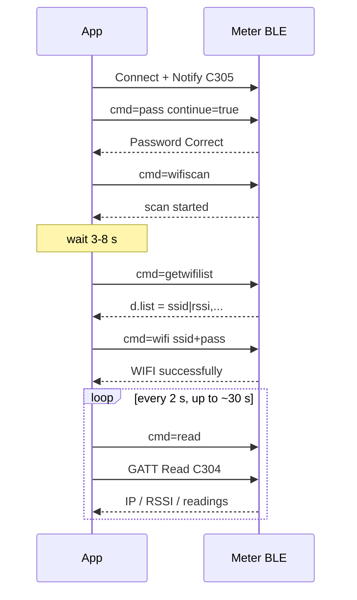

# Energy Meter Plaintext BLE API

Applies to: the plaintext BLE channel (service `A002`) | Document version: v2.0 | Date: 2026-10 | Sample responses verified on a real SDM01_3PN (firmware 5.1.15)

Over Bluetooth Low Energy you can talk to the meter's communication module to: **provision 2.4 GHz Wi-Fi**, read electrical readings and network status, configure MQTT / UDP / Modbus, switch LAN protocols on or off, and trigger locate / restart / OTA.

The protocol is **plaintext UTF-8 JSON**. This document is written for system integrators, DIY developers and AI coding assistants.


> **How the docs are split:** this page covers only the **transport layer** of the plaintext channel (UUIDs, unlock, request/response matching, disconnect and reconnect) plus app-development rules. Provisioning commands, device commands, snapshot fields and business error codes are in the [Business Command Reference (shared by plaintext and secured)](../ble-common/ble-business-api.en.md), maintained once for both channels.

---

## 1. Quick start (5 minutes)

Minimal loop: **connect → subscribe to notifications → unlock → provision Wi-Fi → read the IP to confirm**.

| Item | Value |
|------|-------|
| Advertised name | `<model>-<serial>`, e.g. `SDM01_3PN-10304B0D7760`; filter by prefix `SDM` / `SPM` |
| Service | `0xA002` |
| Write (commands) | `0xC303` |
| Read (snapshot) | `0xC304` |
| Notify (responses) | `0xC305` |
| Factory BLE password | `1234` (max 16 characters) |
| Wi-Fi | **2.4 GHz only** |

### 1.1 Try a tool first (recommended)

If you do not want to write code yet, connect to a meter once with the Chrome page or the Windows tool in [Section 10](#10-demo-tools) to see the flow and the responses.

### 1.2 Minimal runnable example for Chrome / Edge

It already includes: **serialized sending**, `event` matching (including the `pas` special case), unlock, provisioning, and polling `IP`. `requestDevice` must be triggered by a user click.

```javascript
const UUID = {
  service: '0000a002-0000-1000-8000-00805f9b34fb',
  write:   '0000c303-0000-1000-8000-00805f9b34fb',
  read:    '0000c304-0000-1000-8000-00805f9b34fb',
  notify:  '0000c305-0000-1000-8000-00805f9b34fb',
};
const enc = new TextEncoder();
const dec = new TextDecoder();
let writeCh, readCh;
let queue = [];                       // received notifications
let chain = Promise.resolve();        // guarantees one command at a time

function onNotify(ev) {
  const text = dec.decode(ev.target.value);
  try { queue.push(JSON.parse(text)); }
  catch { console.warn('Non-JSON notification ignored:', text); }
}

function waitFor(cmd, timeoutMs) {
  const t0 = Date.now();
  return new Promise((resolve, reject) => {
    const tick = () => {
      // When locked, the device answers with event="pas"
      const i = queue.findIndex(r => r.event === cmd || r.event === 'pas');
      if (i >= 0) return resolve(queue.splice(i, 1)[0]);
      if (Date.now() - t0 > timeoutMs) return reject(new Error('Timeout: ' + cmd));
      setTimeout(tick, 50);
    };
    tick();
  });
}

function rpc(obj, timeoutMs = 12000) {
  const run = async () => {
    queue.length = 0;
    await writeCh.writeValueWithResponse(enc.encode(JSON.stringify(obj)));
    return waitFor(obj.cmd, timeoutMs);
  };
  const p = chain.then(run, run);
  chain = p.catch(() => {});
  return p;
}

async function connectAndUnlock(password = '1234') {
  const dev = await navigator.bluetooth.requestDevice({
    filters: [{ namePrefix: 'SDM' }, { namePrefix: 'SPM' }],
    optionalServices: [UUID.service],
  });
  const server = await dev.gatt.connect();
  const svc = await server.getPrimaryService(UUID.service);
  writeCh = await svc.getCharacteristic(UUID.write);
  readCh  = await svc.getCharacteristic(UUID.read);
  const ntf = await svc.getCharacteristic(UUID.notify);
  ntf.addEventListener('characteristicvaluechanged', onNotify);
  await ntf.startNotifications();                       // subscribe first
  const r = await rpc({ cmd: 'pass', pas: password, continue: true }, 8000);
  if (!r.ok) throw new Error('Unlock failed: ' + r.msg);
}

async function provisionWifi(ssid, wifiPassword) {
  const r = await rpc({ cmd: 'wifi', ssid, pass: wifiPassword }, 20000);
  if (!r.ok) throw new Error(r.msg + ' code=' + r.code);
  for (let i = 0; i < 15; i++) {                         // up to ~30 s
    await new Promise(res => setTimeout(res, 2000));
    await rpc({ cmd: 'read', continue: true }, 8000);
    const snap = JSON.parse(dec.decode(await readCh.readValue()));
    if (String(snap.IP).includes('.')) return snap.IP;   // success only once an IPv4 address appears
  }
  throw new Error('No IPv4 address within 30 seconds');
}
```

---

## 2. Build your own app with AI

Give the AI the **whole of this page** together with the prompt below.

```text
You are implementing a BLE client for the "Energy Meter Plaintext BLE API" below.
1. Use only the plaintext UUIDs: A002 / C303 / C304 / C305. Write UTF-8 JSON with Write With Response.
2. After connecting, subscribe to C305 notifications first, then send {"cmd":"pass","pas":"<password>","continue":true}.
3. Commands must be serialized: write one -> wait for the notification whose event matches -> write the next. No concurrency.
4. Event matching rule: resp.event == cmd OR resp.event == "pas".
5. event=="pas" means the connection is locked: unlock again, do not keep waiting for the original command.
6. After a successful restart / reset / mqtr the device drops the GATT connection: recover with the "reconnect algorithm" in the document and send pass again.
7. Provision Wi-Fi only with {"cmd":"wifi","ssid":"...","pass":"..."}; then poll the IP in C304 and treat a dotted-decimal address as success.
8. If a notification cannot be parsed as JSON, log it and ignore it without crashing; if you suspect a small MTU, tell the user.
9. Never invent commands or fields that are not in the document. If unsure, output a TODO and explain why.
Implement first: scan -> connect -> subscribe -> unlock -> provision Wi-Fi -> poll IP. Then: read electrical data, model, getFunctionMap, mqttdata.
```

After the AI generates code, self-test it with the [acceptance checklist (9.3)](#93-acceptance-checklist).

---

## 3. Overview and scope

### 3.1 What you can do

1. Discover and connect to the device  
2. Unlock the current GATT connection  
3. Send the Wi-Fi SSID and password  
4. Read IP / signal strength / electrical readings  
5. Configure MQTT, UDP and Modbus 485, switch LAN protocols, check / run firmware upgrades  

### 3.2 Does this document apply?

Use this document if both are true:

- The advertised name starts with `SDM` / `SPM`;
- The GATT service `A002` is present.

Do not use this document if:

| Situation | Note |
|-----------|------|
| The service is `A003` and packets contain `nonce` / `ct` / `tag` | Encrypted channel, out of scope |
| You need to control a relay / breaker | This document has no switching commands |
| The device has no Wi-Fi | There is no provisioning path described here |
| You only use HTTP / MQTT, not BLE | See the API document of that channel |

### 3.3 Model differences

Models do not support exactly the same commands. When a command is not supported the device returns a failure: some answer `unsupported`, others `unknow cmd` (1015). For example, models without WebSocket have no `setInterval`; models without LAN TLS have no `enablehttps`. **Clients must handle `ok` / `msg` and must not assume that every device has every command.**

Identify the product by the advertised name and by `TP` and `SN` in the read characteristic, not by what is printed on the enclosure.

---

## 4. GATT and session

### 4.1 UUIDs

Case-insensitive.

| Role | 16-bit | 128-bit |
|------|--------|---------|
| Primary service | `0xA002` | `0000A002-0000-1000-8000-00805F9B34FB` |
| Write (client → meter) | `0xC303` | `0000C303-0000-1000-8000-00805F9B34FB` |
| Read (status snapshot) | `0xC304` | `0000C304-0000-1000-8000-00805F9B34FB` |
| Notify (meter → client) | `0xC305` | `0000C305-0000-1000-8000-00805F9B34FB` |

### 4.2 Transport rules

- Encoding is UTF-8 JSON, no BOM. One command = one Write; one response = one Notify.
- **Subscribe to `C305` before the first command**, otherwise the device looks unresponsive.
- **Commands must be serialized**: write one, wait for its response, then write the next. Do not interleave `C304` polling with command writes.
- Only **one** BLE connection is supported at a time. While connected the device stops advertising, so other clients cannot see it.
- **MTU:** the JSON you write must fit in a single Write (the device accepts about 512 bytes at most; longer input returns `payload too large`). The device sends each response as **one** notification and does no application-level fragmentation, so a response cannot exceed `MTU - 3` bytes. Measured sizes: `model` about 200 bytes, `mqttdata` about 200 bytes, and `getwifilist` (up to 10 networks) can exceed 300 bytes. **If the MTU stays at the default 23, these responses will be truncated** and show up as JSON parse errors. The device requests an MTU of 517; on Windows (bleak) 527 was negotiated in testing; on Android call `requestMtu(517)` after connecting; Web Bluetooth negotiates it in the browser.
- Do not use `A003`, `C313` / `C314` / `C315`, and do not send `nonce` / `ct` / `tag`.

### 4.3 Unlock

**All business JSON on the write characteristic requires unlocking first.** Scanning, connecting and subscribing to notifications do not need a password.

```json
{"cmd":"pass","pas":"1234","continue":true}
```

- Success: `{"ok":true,"msg":"Password Correct","event":"pass"}`
- Wrong password: `Password Error`, `code` 1003
- Business command sent while locked: `Please unlock`, `code` 1002, `event` is `pas`

Meaning of `continue:true`: **within the same BLE connection**, later commands do not need `pas`, and you may read GATT `C304` repeatedly. Your app should **always send `continue:true`**. The session ends on disconnect or device restart and you must unlock again.

`pass` can also carry `newpas` (≤16) to change the password at the same time, or `auth` (≤40) for phone binding. Normal integrations do not need them.

### 4.4 Requests and responses

Request (write to `C303`):

| Field | Type | Description |
|-------|------|-------------|
| `cmd` | string | **Required in every request** |
| `pas` | string | Required only for `cmd=pass` |
| `continue` | boolean | Used with `pass` / `read`, always `true` |
| others | — | See each command |

Response (notification on `C305`):

| Field | Type | Description |
|-------|------|-------------|
| `ok` | boolean | Whether the request succeeded |
| `msg` | string | English text; compare it verbatim |
| `event` | string | Usually equals the request's `cmd`; **`pas` when locked** |
| `code` | integer | **Present only on failure** |
| `d` | object | Only query commands carry data |

**Matching rule (copy it as is):**

```text
match(resp, cmd) = (resp.event == cmd) or (resp.event == "pas")
success = resp.ok == true
```

`event == "pas"` means the gate was not passed: unlock again, do not keep waiting for the original command.

Suggested timeouts: 8–15 s for normal commands, 20 s for `wifi`, 25 s for `checkota` / `startota`.

### 4.5 Disconnect and reconnect

The GATT connection is **persistent**: the device does not close it because of inactivity, but moving away, interference or a device restart will drop it.

**Which commands make the device drop GATT:**

| Command | Drops GATT? | Note |
|---------|-------------|------|
| `restart` | Yes | The device restarts after responding |
| `reset` | Yes | Clears the configuration and restarts |
| `mqtr` | Yes | Saves the MQTT configuration and restarts |
| `mqtt` | No | Saves only, no restart |
| `wifi` | No | BLE stays connected after provisioning, so you can keep polling `C304` for the IP |
| `enablehttp` / `enablewebsocket` / `enablemodbustcp` / `enabletls` / `functionMap` | No | Only saves the configuration and keeps BLE connected; **we recommend sending one `restart` afterwards**, see [Business reference 3.3](../ble-common/ble-business-api.en.md#33-lan-protocol-switches) |
| `startota` | Usually no | If `reboot` is 1 the device restarts about 1 s after a successful upgrade; with an HTTPS URL and low memory it may save the URL and restart immediately |
| all other commands | No | |

**Reconnect algorithm (implement as written):**

```text
Trigger: a successful response to restart / reset / mqtr, or an unexpected GATT disconnect
  1. Wait 4 s (the device needs a few seconds to advertise again after a restart)
  2. Scan for a device with the same name as before and connect
  3. Subscribe to C305 and send {"cmd":"pass","pas":"<password>","continue":true}
  4. On failure retry every ~2.5 s, up to 12 times, then ask the user to reconnect manually
```

---

## 5. Wi-Fi provisioning

A meter usually leaves the factory without router credentials. The phone connects over BLE first, then sends the **2.4 GHz** SSID and the router password. Once it succeeds the meter joins the LAN, and HTTP / MQTT / Modbus TCP and so on become usable.

Everything is written to `C303`; responses come on `C305`.

### 5.1 User flow

1. Turn on Bluetooth and stand close to the meter.  
2. `model-serial` appears in the list; connect and enter the BLE password (factory `1234`).  
3. Optional: have the meter scan nearby Wi-Fi networks and pick an SSID.  
4. Enter the **router password** (not the BLE password) and tap "Send to meter".  
5. After about ten seconds read the status; success is `IP` becoming `192.168.x.x`.

### 5.2 Protocol steps

**A. Unlock** See [4.3](#43-unlock).

**B–D. Scan, send SSID / password, confirm online, UI copy:** the business-layer commands are identical to the secured channel; see [Business Command Reference, Section 2](../ble-common/ble-business-api.en.md#2-wi-fi-provisioning-business-commands).

The whole flow:



---

## 6. Command reference

Write to `C303` after unlock. `event` equals `cmd` by default.

### 6.1 Session (plaintext channel only)

| cmd | Request | Success `msg` | Common failures |
|-----|---------|---------------|-----------------|
| `pass` | `{"cmd":"pass","pas":"1234","continue":true}` | `Password Correct` | 1003 |
| `blepassword` | `{"cmd":"blepassword","old":"1234","new":"654321"}` | `Password yes` | Wrong old password 1026; new password too long 1002 (check `msg`) |
| `read` | `{"cmd":"read","continue":true}` | `ready` | |
| `resetauth` | `{"cmd":"resetauth"}` | | Only needed when phone binding is enabled |

Change the default password with `blepassword` after installation.

### 6.2 Business commands

Wi-Fi, `restart` / `location` / `zero` / `reset` / `deviceName`, `model` / `getFunctionMap` / `mqttdata` / `udpdata`, LAN switches, MQTT, Modbus 485, UDP and OTA are documented once for both channels: [Business Command Reference, Section 3](../ble-common/ble-business-api.en.md#3-command-reference). Command index: [Section 4](../ble-common/ble-business-api.en.md#4-command-index-for-ai-to-scan).

Plaintext-specific notes: after a successful `restart` / `reset` / `mqtr` the device drops the GATT link; reconnect per [4.5](#45-disconnect-and-reconnect) and `pass` again. After changing LAN switches, send one `restart`.

### 6.3 Command index (plaintext-only part)

`pass`, `blepassword`, `read`, `resetauth` (business commands: see the [shared command index](../ble-common/ble-business-api.en.md#4-command-index-for-ai-to-scan))

Do not use command or field names that appear in no document.

---

## 7. Read characteristic C304: IP and electrical readings

The IP and electrical snapshot is obtained with a **GATT Read of `C304`**; do not mix it with notifications.

After `pass` + `continue:true` you can simply read repeatedly. If unsure, first send `{"cmd":"read","continue":true}` and read after you receive `ready`. When locked, a Read returns `{"ok":false,"msg":"Please unlock","code":1002,"event":"read"}`.

Numeric readings are mostly **decimal strings**, not JSON numbers; convert them yourself.

### 7.1 What you read

The JSON fields you read back (`IP` / `RSSI` / `FW` / `SN` / `TP`, electrical keys, units, examples) are the same on both channels; see [Business Command Reference, Section 5](../ble-common/ble-business-api.en.md#5-snapshot-read-ip-and-electrical-readings).

---

## 8. Error codes

On failure the notification or the read characteristic is JSON: `ok=false`, an integer `code` and an English `msg`. **Success packets have no `code`.**

For configuration failures the BLE `code` = **1000 + sub-code**, so some numbers overlap with fixed codes (especially 1002–1005). **Rely on `msg`; use `code` only as a hint.**

### 8.1 Common error codes

| code | `msg` | Meaning / action |
|------|-------|------------------|
| 1000 | auth error | Phone-binding string mismatch. Check `auth` or use `resetauth` |
| 1001 | not authenticated | Binding authentication not completed |
| 1002 | Please unlock | Locked. Send `pass` first. The same code can also be `Error password length!` |
| 1003 | Password Error | Wrong BLE password. Factory default is `1234` |
| 1004 | No cmd | JSON has no `cmd`. The same code can also be `bad value` (invalid number) |
| 1005 | No data received | Required parameter missing. The same code can also be `unsupported` (this model lacks the command) |
| 1026 | Old Password Error | Wrong old password in `blepassword` |
| 1050 | payload too large | Write too long, shorten the JSON |

Business-layer codes (`1014`–`1044` etc., including Wi-Fi / MQTT / UDP) are in [Business Command Reference, Section 6](../ble-common/ble-business-api.en.md#6-business-error-codes); less common codes: [Appendix A](../ble-common/ble-business-api.en.md#appendix-a-less-common-error-codes).

### 8.2 Cases without a `code`

| Symptom | Action |
|---------|--------|
| `msg` is `illegal cmd` / `unsupported` | This model does not have the command |
| The client gets no response (timeout) | `C305` not subscribed, device restarted, too far away, or responses truncated by a small MTU |
| The notification is not JSON | Log it and ignore it, do not crash |

---

## 9. Developer checklist

### 9.1 Hard rules for apps / AI

1. Use only `A002 / C303 / C304 / C305`.  
2. Write UTF-8 JSON with Write With Response; **subscribe to `C305` first** after connecting.  
3. Send `pass` + `continue:true` first.  
4. **Serialize commands**; match by `event`, mind the `pas` special case.  
5. Provision only with `cmd=wifi`; afterwards poll `IP` in `C304`.  
6. After restart-type commands, reconnect and unlock again per [4.5](#45-disconnect-and-reconnect).  
7. Do not use commands or fields that are not in this document.  

### 9.2 Suggested module split

`scan` (name filter) → `connect` (MTU + notify) → `unlock` → `rpc` (write JSON, serialized, wait for event) → `provisionWifi` → `scanWifi` (wifiscan + poll getwifilist) → `readSnapshot` (GATT Read + JSON.parse) → `reconnect`.

### 9.3 Acceptance checklist

- [ ] Nearby meter names are listed  
- [ ] Notifications are subscribed before the first command is sent  
- [ ] A wrong password gives `Password Error`, the right one gives `Password Correct`  
- [ ] `wifi` sent while locked gives `Please unlock` and does not hang until timeout  
- [ ] `wifiscan` → wait → `getwifilist` parses the SSIDs  
- [ ] After `wifi` is sent, `IP` becomes an IPv4 address  
- [ ] Two back-to-back commands do not get mixed up (serialization works)  
- [ ] After `restart` the app reconnects and unlocks again automatically  
- [ ] A non-JSON notification does not crash the app  
- [ ] `model`, `getFunctionMap`, `mqttdata` and `udpdata` can be read  

### 9.4 Platform notes

| Platform | Notes |
|----------|-------|
| Android | Call `requestMtu(517)` after connecting; on status 133 disconnect, wait, then reconnect; keep only one GATT connection at a time |
| iOS | The MAC address is not available; use the advertised name prefix + service UUID; Web Bluetooth is not available, use Core Bluetooth |
| Windows | Use `bleak` in Python; the first scan may prompt for Bluetooth permission |
| Browser | Chrome / Edge only; needs HTTPS or `127.0.0.1`; Firefox and Safari are not supported |

---

## 10. Demo tools

Both tools use exactly the same protocol as this document. We suggest confirming the meter's behavior with a tool before writing your own app. Both tools have a Chinese / English switch; the JSON they exchange is identical to what is described here and is never translated.

**Hosting:** the official hosted web page and the Windows tool download address follow the publishing channel and will be added here once released. Tool sources are in this repository: [`tools/ble-plaintext/`](../../tools/ble-plaintext/) (see [`tools/README.en.md`](../../tools/README.en.md)).

### 10.1 Chrome / Edge web page

1. Use Chrome or Edge. `file://` pages are often blocked from using Bluetooth, so use an HTTPS page, or run `py -3 -m http.server 8765` in `tools/ble-plaintext` and open `http://127.0.0.1:8765/web-ble-console.html`.  
2. Click "Select device and connect", choose the meter in the system dialog; it unlocks automatically (the password box defaults to `1234`).  
3. Enter the SSID and router password, click "Send Wi-Fi", then click "Read IP / readings".  
4. Tabs on the right: **Log**, **Readings**, **Comm config** (Modbus RTU / MQTT / UDP), **Commands / abbreviations**.

### 10.2 Windows GUI tool

```bat
cd tools\ble-plaintext
py -3 -m pip install -r requirements.txt
py -3 ble_plain_gui.py
```

Requires `PyQt6` and `bleak`. It provides: scan / connect / unlock, a Wi-Fi list (double-click to fill the SSID), a readings table, a communication-config page, a command / abbreviation cheat sheet, and custom JSON. With "reconnect automatically after device restart" ticked, restart-type commands need no manual reconnect.

### 10.3 Which one to use

| Situation | Use |
|-----------|-----|
| Demonstrating provisioning, Chrome available | Web page |
| Factory PC with Python | Windows tool |
| Writing an iOS app | Follow the JSON in this document and use Core Bluetooth |
| Writing an Android app | Verify the protocol with the web page first, then write the native app |

---

## 11. Security notes

The BLE password limits "whether you can change the configuration once connected"; it is **not** over-the-air encryption. The plaintext channel has no link-layer encryption, so anyone near the device can capture the traffic. The Wi-Fi password is also sent in plaintext during provisioning.

Recommendations:

- After installation, change the default password `1234` with `blepassword`;
- Do not treat BLE as a remote secure channel; send confidential data over HTTPS / MQTTS after the device is online;
- The plaintext channel does not close GATT automatically when nobody is connected for a long time, so consider physical security for on-site deployments.

---

## Appendix

Appendix A (less common error codes), B (`functionMap` bits) and C (`model` short keys) are shared by both channels; see the [Business Command Reference](../ble-common/ble-business-api.en.md).
