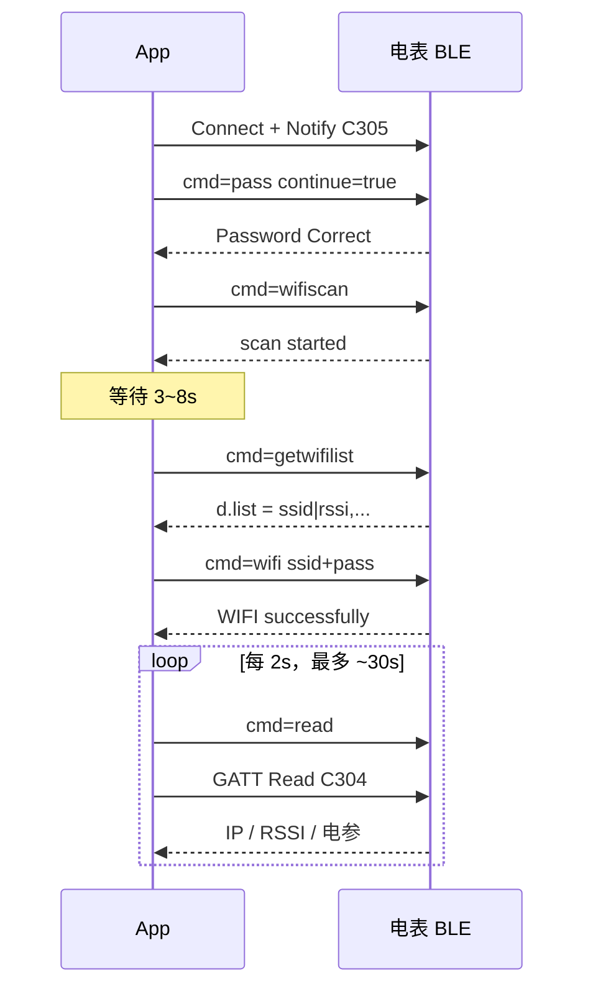

# 电表明文 BLE 接口说明

适用固件：明文 BLE 通道（服务 `A002`）　|　文档版本：v2.1　|　日期：2026-10　|　示例应答已在 SDM01_3PN（固件 5.1.15）上实机校对

通过低功耗蓝牙连接电表通讯模组，可以：**把 2.4 GHz Wi-Fi 配进电表**、读电参与联网状态、配置 MQTT / UDP / Modbus、开关局域网通讯功能、触发定位 / 重启 / OTA。

协议是 **明文 UTF-8 JSON**。本文面向系统集成商、DIY 开发者和 AI 编程助手。


> **文档分工：** 本页只讲明文通道的**传输层**（UUID、解锁、请求/应答匹配、断开与重连）和 App 开发要求。配网命令、设备命令、读快照字段、业务错误码在 [业务命令参考（明文 / 加密共用）](../ble-common/ble-business-api.zh-CN.md)，两个通道共用一份。

---

## 1. 快速开始（5 分钟）

最小闭环：**连接 → 订阅通知 → 解锁 → 配 Wi-Fi → 读 IP 确认**。

| 项 | 值 |
|----|----|
| 广播名 | `<型号>-<序列号>`，如 `SDM01_3PN-10304B0D7760`；按前缀 `SDM` / `SPM` / `SXM` 过滤 |
| 服务 | `0xA002` |
| 写命令 | `0xC303` |
| 读快照 | `0xC304` |
| 通知应答 | `0xC305` |
| 出厂 BLE 密码 | `1234`（最长 16） |
| Wi-Fi | 仅 **2.4 GHz** |

### 1.1 先用工具验证（推荐）

不想先写代码，请先用 [第 10 节](#10-体验工具) 的 Chrome 页或 Windows 工具连一次电表，确认流程和应答。

### 1.2 Chrome / Edge 最小可运行示例

已包含：**串行发送**、`event` 匹配（含 `pas` 特例）、解锁、配网、轮询 `IP`。`requestDevice` 必须由用户点击触发。

```javascript
const UUID = {
  service: '0000a002-0000-1000-8000-00805f9b34fb',
  write:   '0000c303-0000-1000-8000-00805f9b34fb',
  read:    '0000c304-0000-1000-8000-00805f9b34fb',
  notify:  '0000c305-0000-1000-8000-00805f9b34fb',
};
const enc = new TextEncoder();
const dec = new TextDecoder();
let writeCh, readCh;
let queue = [];                       // 收到的通知
let chain = Promise.resolve();        // 保证一次只发一条命令

function onNotify(ev) {
  const text = dec.decode(ev.target.value);
  try { queue.push(JSON.parse(text)); }
  catch { console.warn('非 JSON 通知，已忽略:', text); }
}

function waitFor(cmd, timeoutMs) {
  const t0 = Date.now();
  return new Promise((resolve, reject) => {
    const tick = () => {
      // 未解锁时设备会回 event="pas"
      const i = queue.findIndex(r => r.event === cmd || r.event === 'pas');
      if (i >= 0) return resolve(queue.splice(i, 1)[0]);
      if (Date.now() - t0 > timeoutMs) return reject(new Error('超时: ' + cmd));
      setTimeout(tick, 50);
    };
    tick();
  });
}

function rpc(obj, timeoutMs = 12000) {
  const run = async () => {
    queue.length = 0;
    await writeCh.writeValueWithResponse(enc.encode(JSON.stringify(obj)));
    return waitFor(obj.cmd, timeoutMs);
  };
  const p = chain.then(run, run);
  chain = p.catch(() => {});
  return p;
}

async function connectAndUnlock(password = '1234') {
  const dev = await navigator.bluetooth.requestDevice({
    filters: [{ namePrefix: 'SDM' }, { namePrefix: 'SPM' }, { namePrefix: 'SXM' }],
    optionalServices: [UUID.service],
  });
  const server = await dev.gatt.connect();
  const svc = await server.getPrimaryService(UUID.service);
  writeCh = await svc.getCharacteristic(UUID.write);
  readCh  = await svc.getCharacteristic(UUID.read);
  const ntf = await svc.getCharacteristic(UUID.notify);
  ntf.addEventListener('characteristicvaluechanged', onNotify);
  await ntf.startNotifications();                       // 必须先订阅
  const r = await rpc({ cmd: 'pass', pas: password, continue: true }, 8000);
  if (!r.ok) throw new Error('解锁失败: ' + r.msg);
}

async function provisionWifi(ssid, wifiPassword) {
  const r = await rpc({ cmd: 'wifi', ssid, pass: wifiPassword }, 20000);
  if (!r.ok) throw new Error(r.msg + ' code=' + r.code);
  for (let i = 0; i < 15; i++) {                         // 最多约 30 秒
    await new Promise(res => setTimeout(res, 2000));
    await rpc({ cmd: 'read', continue: true }, 8000);
    const snap = JSON.parse(dec.decode(await readCh.readValue()));
    if (String(snap.IP).includes('.')) return snap.IP;   // 拿到 IPv4 才算成功
  }
  throw new Error('30 秒内没有拿到 IPv4');
}
```

---

## 2. 用 AI 写你自己的 App

把**本页全文**连同下面这段提示词交给 AI。

```text
你要实现一个 BLE 客户端，对接下面的"电表明文 BLE 接口说明"。
1. 只使用明文 UUID：A002 / C303 / C304 / C305。写 UTF-8 JSON，Write With Response。
2. 连接后先订阅 C305 通知，再发 {"cmd":"pass","pas":"<密码>","continue":true}。
3. 命令必须串行：写一条 → 等 event 匹配的通知 → 再写下一条。禁止并发。
4. event 匹配规则：resp.event == cmd 或 resp.event == "pas"。
5. 收到 event=="pas" 表示未解锁，应重新解锁，不要继续等原命令。
6. restart / reset / mqtr 成功后设备会断开 GATT：按文档"重连算法"恢复并重新 pass。
7. 配网只用 {"cmd":"wifi","ssid":"...","pass":"..."}；成功后轮询 C304 的 IP，出现点分十进制才算成功。
8. 收到无法解析为 JSON 的通知：记录日志并忽略，不要崩溃；怀疑 MTU 过小时提示用户。
9. 文档里没有的命令和字段一律不要编造；不确定就输出 TODO 并说明原因。
先实现：扫描 → 连接 → 订阅 → 解锁 → 配 Wi-Fi → 轮询 IP。再实现：读电参、model、getFunctionMap、mqttdata。
```

AI 生成代码后，用 [9.3 验收清单](#93-验收清单) 自测。

---

## 3. 概述与适用范围

### 3.1 你能做什么

1. 发现并连接设备  
2. 解锁本次 GATT 连接  
3. 下发 Wi-Fi 名称与密码  
4. 读 IP / 信号 / 电参  
5. 配 MQTT、UDP、Modbus 485 参数，开关局域网通讯，查 / 升级固件  

### 3.2 适用判断

满足下面两点，就按本文对接：

- 广播名前缀为 `SDM` / `SPM` / `SXM`；
- 能发现 GATT 服务 `A002`。

不要按本文对接：

| 情况 | 说明 |
|------|------|
| 服务是 `A003`，报文含 `nonce` / `ct` / `tag` | 加密通道，不在本文范围 |
| 需要控制继电器 / 通断器 | 本文不含开关控制命令 |
| 设备没有 Wi-Fi | 没有本文的配网路径 |
| 只走 HTTP / MQTT、不经过 BLE | 见对应通道的 API 文档 |

### 3.3 型号差异

不同型号支持的命令不完全一致，不支持时设备返回失败：有的回 `unsupported`，有的回 `unknow cmd`（1015）。例如：没有 WebSocket 的型号没有 `setInterval`；没有局域网 TLS 的型号没有 `enablehttps`。**客户端必须按 `ok` / `msg` 处理，不要假设每台设备都有全部命令。**

产品身份以广播名和读特征里的 `TP`、`SN` 为准，不要按外壳丝印写死。

---

## 4. GATT 与会话

### 4.1 UUID

大小写不敏感。

| 角色 | 16 位 | 128 位 |
|------|-------|--------|
| 主服务 | `0xA002` | `0000A002-0000-1000-8000-00805F9B34FB` |
| 写（客户端 → 电表） | `0xC303` | `0000C303-0000-1000-8000-00805F9B34FB` |
| 读（状态快照） | `0xC304` | `0000C304-0000-1000-8000-00805F9B34FB` |
| 通知（电表 → 客户端） | `0xC305` | `0000C305-0000-1000-8000-00805F9B34FB` |

### 4.2 传输规则

- 编码 UTF-8 JSON，不要 BOM。一条命令 = 一次 Write；一条应答 = 一次 Notify。
- **订阅 `C305` 必须在发第一条命令之前**，否则看起来像设备没反应。
- **命令必须串行**：写一条，等到对应应答，再写下一条。轮询 `C304` 不要与写命令交错。
- 同一时刻只支持**一个** BLE 连接。已连接时设备停止广播，新客户端扫不到。
- **MTU：** 写入的 JSON 要放进一次 Write（设备侧最大约 512，过长返回 `payload too large`）。设备一条应答只发**一包**通知，不做应用层分包，所以单条应答不能超过 `MTU - 3` 字节。实测 `model` 约 200 字节、`mqttdata` 约 200 字节，`getwifilist` 最多 10 个热点，可能超过 300 字节；**MTU 停在默认 23 时这些应答会被截断**，表现为 JSON 解析失败。设备端请求的 MTU 是 517，Windows（bleak）实测协商到 527；Android 请在连接后 `requestMtu(517)`；Web Bluetooth 由浏览器协商。
- 不要使用 `A003`、`C313` / `C314` / `C315`，不要发 `nonce` / `ct` / `tag`。

### 4.3 解锁

写特征上的**全部业务 JSON 都要先解锁**。扫描、连接、订阅通知本身不需要密码。

```json
{"cmd":"pass","pas":"1234","continue":true}
```

- 成功：`{"ok":true,"msg":"Password Correct","event":"pass"}`
- 密码错：`Password Error`，`code` 1003
- 未解锁就发业务命令：`Please unlock`，`code` 1002，`event` 为 `pas`

`continue:true` 的含义：**同一 BLE 连接内**后续命令不必再带 `pas`，并且可以反复 GATT Read `C304`。客户 App **始终带 `continue:true`**。断开或设备重启后会话作废，必须重新解锁。

`pass` 还可选带 `newpas`（≤16）同时改密，或 `auth`（≤40）做手机绑定；普通集成不需要。

### 4.4 请求与应答

请求（写 `C303`）：

| 字段 | 类型 | 说明 |
|------|------|------|
| `cmd` | string | **每条必填** |
| `pas` | string | 仅 `cmd=pass` 必填 |
| `continue` | boolean | 用在 `pass` / `read`，始终 `true` |
| 其它 | — | 见各命令 |

应答（通知 `C305`）：

| 字段 | 类型 | 说明 |
|------|------|------|
| `ok` | boolean | 是否成功 |
| `msg` | string | 英文原文，按原文比对 |
| `event` | string | 通常等于请求的 `cmd`；**未解锁时为 `pas`** |
| `code` | integer | **仅失败时出现** |
| `d` | object | 仅查询类命令带数据 |

**匹配规则（请直接照抄）：**

```text
match(resp, cmd) = (resp.event == cmd) or (resp.event == "pas")
成功 = resp.ok == true
```

`event == "pas"` 表示没通过门禁：重新解锁，不要继续等原命令。

建议超时：一般命令 8～15 秒；`wifi` 20 秒；`checkota` / `startota` 25 秒。

### 4.5 断开与重连

GATT 是**保持型连接**，不会因为长时间不操作被设备主动关闭，但走远、干扰或设备重启会断。

**哪些命令会让设备断开 GATT：**

| 命令 | 是否断开 | 说明 |
|------|----------|------|
| `restart` | 是 | 应答后设备重启 |
| `reset` | 是 | 清空配置并重启 |
| `mqtr` | 是 | 保存 MQTT 配置后重启 |
| `mqtt` | 否 | 只保存，不重启 |
| `wifi` | 否 | 配网成功后 BLE 保持连接，可继续读 `C304` 轮询 IP |
| `enablehttp` / `enablewebsocket` / `enablemodbustcp` / `enabletls` / `functionMap` | 否 | 只保存配置，不断开 BLE；**建议改完后发一次 `restart`**，见 [业务命令参考 3.3](../ble-common/ble-business-api.zh-CN.md#33-通讯开关) |
| `startota` | 通常否 | 升级完成且 `reboot` 为 1 时约 1 秒后重启；用 HTTPS 地址且设备内存不足时可能先保存地址并立即重启 |
| 其它命令 | 否 | |

**重连算法（建议原样实现）：**

```text
触发条件：收到 restart / reset / mqtr 的成功应答，或 GATT 意外断开
  1. 等 4 秒（设备重启后需要几秒才重新广播）
  2. 扫描与上次相同名称的设备，连接
  3. 订阅 C305，发 {"cmd":"pass","pas":"<密码>","continue":true}
  4. 失败则每隔约 2.5 秒重试，最多 12 次，仍失败再提示用户手动重连
```

---

## 5. Wi-Fi 配网

电表出厂时通常还没有路由器账号。手机先 BLE 连接，再下发 **2.4 GHz** 的 SSID 和路由器密码。成功后电表加入局域网，HTTP / MQTT / Modbus TCP 等才可用。

全部写 `C303`，应答走 `C305`。

### 5.1 用户视角

1. 打开蓝牙，靠近电表。  
2. 列表里出现 `型号-序列号`，连接并输入 BLE 密码（出厂 `1234`）。  
3. 可选：让电表扫描附近 Wi-Fi，点选 SSID。  
4. 输入**路由器密码**（不是 BLE 密码），点「发送到电表」。  
5. 十几秒后读状态，`IP` 变成 `192.168.x.x` 即成功。

### 5.2 协议步骤

**A. 解锁** 见 [4.3](#43-解锁)。

**B～D. 扫热点、下发 SSID / 密码、确认上网、界面文案**：业务层命令与加密通道完全相同，见 [业务命令参考第 2 节](../ble-common/ble-business-api.zh-CN.md#2-wi-fi-配网业务命令)。

整个流程：



---

## 6. 命令参考

解锁后写 `C303`。`event` 默认等于 `cmd`。

### 6.1 会话（明文通道专有）

| cmd | 请求 | 成功 `msg` | 常见失败 |
|-----|------|-----------|----------|
| `pass` | `{"cmd":"pass","pas":"1234","continue":true}` | `Password Correct` | 1003 |
| `blepassword` | `{"cmd":"blepassword","old":"1234","new":"654321"}` | `Password yes` | 旧密码错 1026；新密码过长 1002（看 `msg`） |
| `read` | `{"cmd":"read","continue":true}` | `ready` | |
| `resetauth` | `{"cmd":"resetauth"}` | | 仅启用了手机绑定时需要 |

装机后建议用 `blepassword` 修改默认密码。

### 6.2 业务命令

Wi-Fi、`restart` / `location` / `zero` / `reset` / `deviceName`、`model` / `getFunctionMap` / `mqttdata` / `udpdata`、通讯开关、MQTT、Modbus 485、UDP、OTA 等业务命令，两个通道共用一份说明：[业务命令参考第 3 节](../ble-common/ble-business-api.zh-CN.md#3-命令参考)。命令索引见 [第 4 节](../ble-common/ble-business-api.zh-CN.md#4-命令索引给-ai-扫)。

明文通道额外注意：`restart` / `reset` / `mqtr` 成功后设备会断开 GATT，按 [4.5](#45-断开与重连) 重连并重新 `pass`；改完通讯开关后建议统一 `restart`。

### 6.3 命令索引（明文通道专有部分）

`pass`, `blepassword`, `read`, `resetauth`（业务命令见 [公共命令索引](../ble-common/ble-business-api.zh-CN.md#4-命令索引给-ai-扫)）

不要使用任何文档里没有的命令名和字段名。

---

## 7. 读特征 C304：IP 与电参

电参与 IP 快照**走 `C304` 的 GATT Read**，不要和通知混用。

已 `pass` + `continue:true` 后可直接反复 Read。若不确定，先发 `{"cmd":"read","continue":true}`，收到 `ready` 再 Read。未解锁时 Read 得到 `{"ok":false,"msg":"Please unlock","code":1002,"event":"read"}`。

数值类电参多为**十进制字符串**，不是 JSON number，请自行转换。

### 7.1 读到什么

读到的 JSON 字段（`IP` / `RSSI` / `FW` / `SN` / `TP` 与电参键、单位、示例）两个通道相同，见 [业务命令参考第 5 节](../ble-common/ble-business-api.zh-CN.md#5-读快照ip-与电参)。

---

## 8. 错误码

失败时通知或读特征为 JSON：`ok=false`，整数 `code`，英文 `msg`。**成功包没有 `code`。**

配置类失败时，BLE 上的 `code` = **1000 + 子码**。所以部分数字会和固定码重叠（尤其 1002～1005）。**请以 `msg` 为准，`code` 只作辅助。**

### 8.1 常用错误码

| code | `msg` | 含义 / 处理 |
|------|-------|-------------|
| 1000 | auth error | 手机绑定串不匹配。检查 `auth` 或 `resetauth` |
| 1001 | not authenticated | 未完成绑定认证 |
| 1002 | Please unlock | 未解锁。先发 `pass`。同码也可能是 `Error password length!` |
| 1003 | Password Error | BLE 密码错。出厂 `1234` |
| 1004 | No cmd | JSON 缺少 `cmd`。同码也可能是 `bad value`（数值非法） |
| 1005 | No data received | 缺必要参数。同码也可能是 `unsupported`（本型号没有该命令） |
| 1026 | Old Password Error | `blepassword` 旧密码错 |
| 1050 | payload too large | 写入过长，缩短 JSON |

业务层错误码（`1014`～`1044` 等，含 Wi-Fi / MQTT / UDP 类）见 [业务命令参考第 6 节](../ble-common/ble-business-api.zh-CN.md#6-业务错误码)；低频码见 [附录 A](../ble-common/ble-business-api.zh-CN.md#附录-a-低频错误码)。

### 8.2 没有 `code` 的情况

| 现象 | 处理 |
|------|------|
| `msg` 为 `illegal cmd` / `unsupported` | 本型号没有该命令 |
| 客户端等不到应答（超时） | 未订阅 `C305`、设备重启、距离过远，或 MTU 过小导致应答被截断 |
| 通知不是 JSON | 记录日志并忽略，不要崩溃 |

---

## 9. 开发清单

### 9.1 给 App / AI 的硬约束

1. 只用 `A002 / C303 / C304 / C305`。  
2. 写 UTF-8 JSON，Write With Response；连接后**先订阅 `C305`**。  
3. 先 `pass` + `continue:true`。  
4. **命令串行**；用 `event` 匹配，注意 `pas` 特例。  
5. 配网只用 `cmd=wifi`；成功后轮询 `C304` 的 `IP`。  
6. 重启类命令后按 [4.5](#45-断开与重连) 重连并重新解锁。  
7. 不要使用本文没有的命令和字段。  

### 9.2 建议模块划分

`scan`（名称过滤）→ `connect`（MTU + notify）→ `unlock` → `rpc`（写 JSON、串行、等 event）→ `provisionWifi` → `scanWifi`（wifiscan + 轮询 getwifilist）→ `readSnapshot`（GATT Read + JSON.parse）→ `reconnect`。

### 9.3 验收清单

- [ ] 能列出附近电表广播名  
- [ ] 连接后已订阅通知，再发第一条命令  
- [ ] 错误密码得到 `Password Error`，正确密码得到 `Password Correct`  
- [ ] 未解锁发 `wifi` 得到 `Please unlock`，且不会卡到超时  
- [ ] `wifiscan` → 等待 → `getwifilist` 能解析 SSID  
- [ ] `wifi` 下发后 `IP` 变为 IPv4  
- [ ] 连发两条命令不会串包（串行生效）  
- [ ] `restart` 后能自动重连并重新解锁  
- [ ] 收到非 JSON 通知不崩溃  
- [ ] 能读到 `model`、`getFunctionMap`、`mqttdata`、`udpdata`  

### 9.4 各平台提示

| 平台 | 提示 |
|------|------|
| Android | 连接后 `requestMtu(517)`；遇到状态码 133 先断开、延时再重连；一次只保持一个 GATT 连接 |
| iOS | 拿不到 MAC，用广播名前缀 + 服务 UUID；Web Bluetooth 不可用，请用 Core Bluetooth |
| Windows | Python 用 `bleak`；首次扫描可能弹蓝牙权限 |
| 浏览器 | 仅 Chrome / Edge；需要 HTTPS 或 `127.0.0.1`；Firefox、Safari 不支持 |

---

## 10. 体验工具

两套工具协议和本文完全一致。建议先用工具确认电表行为，再写自己的 App。工具界面支持中 / 英切换，收发的 JSON 不翻译。

**托管地址：** 官方托管的网页地址与 Windows 工具下载地址以发布渠道为准，发布后补充到这里。工具源码见本仓库 [`tools/ble-plaintext/`](../../tools/ble-plaintext/)（说明见 [`tools/README.md`](../../tools/README.md)）。

### 10.1 Chrome / Edge 网页

1. 使用 Chrome 或 Edge；`file://` 常被拦截蓝牙，请用 HTTPS 页面，或在 `tools/ble-plaintext` 目录运行 `py -3 -m http.server 8765` 后访问 `http://127.0.0.1:8765/web-ble-console.html`。  
2. 点「选择设备并连接」，在系统弹窗选电表，会自动解锁（密码框默认 `1234`）。  
3. 填 SSID 与路由器密码，点「发送 Wi-Fi」，再点「读 IP / 电参」。  
4. 右侧页签：**日志**、**电参**、**通讯配置**（Modbus RTU / MQTT / UDP）、**命令/缩写速查**。

### 10.2 Windows 图形工具

```bat
cd tools\ble-plaintext
py -3 -m pip install -r requirements.txt
py -3 ble_plain_gui.py
```

依赖 `PyQt6`、`bleak`。界面包含：扫描 / 连接 / 解锁、Wi-Fi 列表（双击填 SSID）、电参表、通讯配置页、命令/缩写速查、自定义 JSON。勾选"设备重启后自动重连"后，重启类命令不需要手工重连。

### 10.3 怎么选

| 环境 | 用哪个 |
|------|--------|
| 演示配网，有 Chrome | 网页 |
| 工厂电脑有 Python | Windows 工具 |
| 写 iOS App | 按本文 JSON，用 Core Bluetooth |
| 写 Android App | 先用网页验证协议，再写原生 App |

---

## 11. 安全说明

BLE 密码的作用是限制"连上之后能不能改配置"，**不是**空口加密。明文通道没有链路层加密，靠近设备的人可以抓包。Wi-Fi 密码在配网时也是明文下发。

建议：

- 装机后用 `blepassword` 修改默认密码 `1234`；
- 不要把 BLE 当远程安全通道；需要保密的数据走联网之后的 HTTPS / MQTTS；
- 明文通道不会因长时间无人连接而自动关闭 GATT，现场部署请结合物理安全考虑。

---

## 附录

附录 A（低频错误码）、附录 B（`functionMap` 位）、附录 C（`model` 短键）两个通道共用，见 [业务命令参考](../ble-common/ble-business-api.zh-CN.md)。
