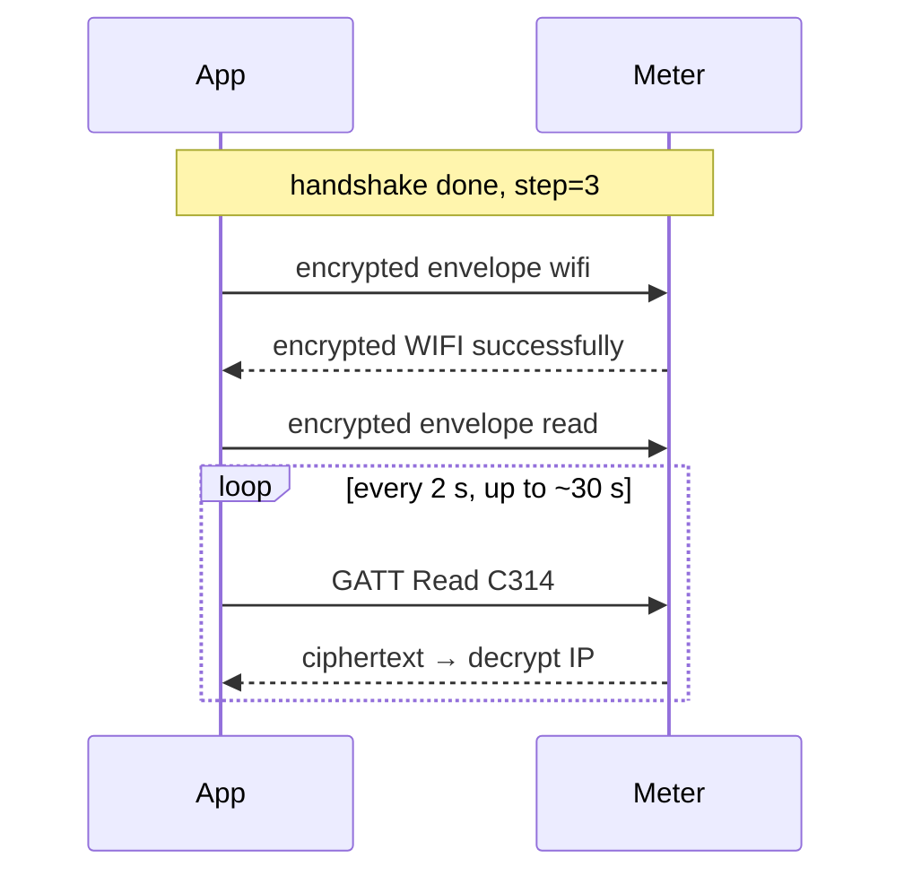

# Energy Meter Secured BLE (Crypto) API

Firmware: **Lite / Pro** (secured channel, service `A003`)　|　Doc version: v1.1　|　Date: 2026-10　|　Crypto details aligned with the [protocol reference](crypto-protocol.en.md) (V2)　|　Handshake, encrypted provisioning and read/write have been run end to end on real meters with the Windows tool and web page in this repository

Over BLE you can: **establish an application-layer secure session**, **provision 2.4 GHz Wi-Fi**, read metering / link status, configure MQTT / UDP / Modbus, toggle LAN features, locate / restart / OTA.

- Before the secure channel is up: plaintext UTF-8 JSON.  
- After it is up: business messages use an **encrypted envelope** (`nonce` / `ct` / `tag`).  

For system integrators, DIY developers, and AI coding assistants. Command names, field names, and device `msg` strings stay in English exactly as the device returns them.

> **How the docs are split:** this page covers the **transport layer** of the secured channel — UUIDs, handshake, key-derivation summary, encrypted envelope, reconnect. Provisioning commands, device commands, snapshot fields and business error codes are in the [Business Command Reference (shared by plaintext and secured)](../ble-common/ble-business-api.en.md); the decrypted business JSON is **identical** to the plaintext channel and maintained only once. The J-PAKE / ZKP binary layout and advertising manufacturer-data details are in the [protocol reference](crypto-protocol.en.md); **if the documents disagree, the protocol reference wins**.

Overview: [SPM/SDM Open Wi-Fi API Overview](https://docs.bituo-technik.com/device-api/spm-sdm-open-wi-fi-api-overview) (BLE Secured applies to Lite/Pro).

---

## 1. Quick start (5 minutes)

Minimal loop: **connect → subscribe notify → secure handshake → encrypted Wi-Fi → poll IP**.

| Item | Value |
|------|-------|
| Advertised name | `<model>-<serial>`, e.g. `SDM01_3PN-10304B0D7760`; filter prefixes `SDM` / `SPM` / `SXM` |
| Service | `0xA003` |
| Write | `0xC313` |
| Read snapshot | `0xC314` |
| Notify | `0xC315` |
| PIN | **8 digits** printed on the meter (`0-9` only) — **not** the plaintext `1234`. The **11 digits under the QR code** can be converted to the 8-digit PIN by the tools, see [4.3](#43-authentication-material) |
| SN | Device serial (often the 12 hex characters after `-` in the name); used in PBKDF2 / HKDF |
| Wi-Fi | **2.4 GHz only** |

### 1.1 Plaintext vs secured (mutually exclusive)

| | Plaintext BLE (Basic / Basic+) | Secured BLE (Lite / Pro, this doc) |
|--|--------------------------------|-------------------------------------|
| Service | `0xA002` | `0xA003` |
| Write / read / notify | `C303` / `C304` / `C305` | `C313` / `C314` / `C315` |
| Gate | `cmd=pass` + BLE password | EC J-PAKE (PIN + SN) |
| Business payload | Plain JSON | Encrypted envelope after handshake |

One firmware never exposes both application GATT sets. If you only see `A002`, use the [Plaintext BLE API](../ble-plaintext/ble-plaintext-api.en.md) and tools.

### 1.2 Validate with tools first

Use the **Windows GUI** or the **Chrome / Edge page** from [Section 10](#10-demo-tools) to run one full handshake and provisioning (both implement EC J-PAKE + AES-CCM).

### 1.3 Minimal flow (conceptual)

```text
1. requestDevice / scan → connect → startNotifications(C315)
2. Plain write {"cmd":"ble-crypto-ver"} → read d.ver, d.step
3. Branch on step:
   step==0: PBKDF2(PIN, SN, ver) → EC J-PAKE round1/round2 → derive LTK / session_key → step=3
   step==2: resume with cached LTK + ble-crypto-session-nonce → step=3
   step==1: ble-crypto-reset to return to step 0, or reconnect
   step==3: the device already handshook on THIS connection; if you hold the local session, just send business;
            if not, disconnect and reconnect (see 4.11)
4. Encrypt-send {"cmd":"wifi","ssid":"...","pass":"..."}
5. Encrypt-send {"cmd":"read"}, then GATT Read C314 (decrypt) until IP is IPv4
```

Key derivation and the envelope are in [Section 4](#4-gatt--session--secure-handshake). **Reference implementations:** [`tools/ble-secured/ble_crypto_core.py`](../../tools/ble-secured/ble_crypto_core.py) (Python) and [`tools/ble-secured/ble_secured_crypto.js`](../../tools/ble-secured/ble_secured_crypto.js) (browser / JS); cross-check one against the other.

---

## 2. Prompt template for AI apps

Give the AI **this page, the [Business Command Reference](../ble-common/ble-business-api.en.md) and the [protocol reference](crypto-protocol.en.md) in full**, plus the prompt below. (The repository can also generate single-file bundles; see [`AGENTS.en.md`](../../AGENTS.en.md).)

```text
You are implementing a BLE client for the "Energy Meter Secured BLE API" (Lite/Pro), the "Business Command Reference" and the "Protocol Reference" provided.
1. Use only the secured UUIDs: A003 / C313 / C314 / C315. Never use A002 / C303 / C304 / C305.
2. After connecting, subscribe to C315 first, then send the plaintext {"cmd":"ble-crypto-ver"} and branch on d.step:
   - step=0: PBKDF2(PIN, salt=SN||ver||"PBKDF2", iter=10000) → EC J-PAKE (secp256r1) round1/round2 → HKDF to LTK/session_key;
   - step=2: ble-crypto-session-nonce + stored LTK to restore session_key;
   - step=1: ble-crypto-reset, or reconnect and start again;
   - step=3: the device already secured THIS connection. Continue if you hold the local session; otherwise disconnect and reconnect — do not send J-PAKE again.
3. Handshake JSON goes in plaintext; after the channel is up every business message must be an AES-128-CCM envelope {nonce,ct,tag} (8-byte tag; the JSON nonce is a uint32 counter, strictly increasing client->device).
4. Commands are strictly serial: write one → wait for the matching (decrypted) notification → write the next. No concurrency.
5. Provision with the encrypted {"cmd":"wifi","ssid":"...","pass":"..."}; then send encrypted {"cmd":"read"} and poll GATT Read C314 (decrypt); success only when IP is a dotted IPv4.
6. The PIN is exactly 8 digits from the meter body; never invent a field PIN. The device persists the LTK only after Wi-Fi STA association succeeds.
7. Never send the plaintext-channel pass / blepassword / resetauth.
8. Never invent commands or fields that are not in the docs; output a TODO with the reason when unsure. Do not change a single algorithm parameter (curve, iteration count, info strings).
Implement first: scan → connect → subscribe → handshake → encrypted Wi-Fi → poll IP. Then: electrical readings, model, getFunctionMap, mqttdata.
Validate your PBKDF2 / HKDF / AES-CCM against spec/ble-secured-test-vectors.json before touching a real meter.
```

After the AI generates code, self-test with the [9.3 acceptance checklist](#93-acceptance-checklist).

---

## 3. Overview and scope

### 3.1 What you can do

1. Discover and connect (service `A003`)  
2. Complete the secure handshake or resume a session  
3. Send the Wi-Fi name and password in encrypted envelopes  
4. Read IP / signal / electrical readings  
5. Configure MQTT, UDP and Modbus 485, toggle LAN protocols, check / upgrade firmware  

### 3.2 When to use this doc

Use it when both hold:

- the advertised name starts with `SDM` / `SPM` / `SXM`;  
- the GATT service `A003` is present.

Do **not** use it when:

| Situation | Note |
|-----------|------|
| Service is `A002` and there is no `nonce` / `ct` / `tag` envelope | Plaintext channel; see the [Plaintext BLE API](../ble-plaintext/ble-plaintext-api.en.md) |
| You need relay / switch control | No switching commands here |
| The device has no Wi-Fi | No provisioning path |
| Only HTTP / MQTT, no BLE | See that channel's API doc |

### 3.3 Branch differences

| Firmware branch | BLE | TLS (summary) |
|-----------------|-----|---------------|
| Lite | Secured | MQTT TLS on Wi-Fi; HTTP / Modbus / WS without TLS (see the Overview matrix) |
| Pro | Secured | Up to ~2 concurrent TLS sessions; HTTPS available (see Overview) |

Models do not support exactly the same business commands; unsupported ones fail (`unsupported` / `unknow cmd` etc.). **Clients must act on `ok` / `msg`.** Product identity comes from the advertised name and `TP` / `SN` in the snapshot.

---

## 4. GATT / session / secure handshake

### 4.1 UUIDs

Case-insensitive. The full 128-bit value is the 16-bit value combined with the standard Bluetooth base UUID:

| Role | 16-bit | 128-bit |
|------|--------|---------|
| Primary service | `0xA003` | `0000A003-0000-1000-8000-00805F9B34FB` |
| Write (client → meter) | `0xC313` | `0000C313-0000-1000-8000-00805F9B34FB` |
| Read (status snapshot) | `0xC314` | `0000C314-0000-1000-8000-00805F9B34FB` |
| Notify (meter → client) | `0xC315` | `0000C315-0000-1000-8000-00805F9B34FB` |

### 4.2 Transport rules

- UTF-8 JSON, no BOM. During the handshake: one command = one Write; one reply = one Notify.  
- **Subscribe to `C315` before the first command.**  
- **Commands are strictly serial.** Do not interleave `C314` polling with writes.  
- Normally only one BLE connection at a time; while a client is connected the meter stops advertising and new clients cannot see it.  
- **MTU:** the Base64 of Round1 is long, so the protocol supports chunking (`client_round1_part` / `fetch_next`; see the protocol reference). Business envelopes are also bounded by MTU, and one reply is a single notification, so an MTU left at the default 23 truncates replies. On Android call `requestMtu(517)` after connecting; Windows (bleak) negotiates 527 in practice; Web Bluetooth lets the browser negotiate.  
- Never use `A002` / `C303` / `C304` / `C305`.

### 4.3 Authentication material

| Material | Rule |
|----------|------|
| `PIN` | Exactly **8** digit characters (`0-9`), obtainable **only from the meter body** |
| `SN` | Unique serial; part of salt / info |
| `ver` | Literal `d.ver` returned by `ble-crypto-ver` (e.g. `BT_Crypto_V1`) |

**The 11 digits under the QR code:** this is a checksummed manual pairing code (Verhoeff check) that converts to the 8-digit PIN. **The protocol itself only knows the 8-digit PIN**; the conversion is a client convenience: the input box of the tools in this repo accepts both (an 11-digit code is validated and then decoded to 8 digits). Reference implementations: Python `pin_from_manual_pairing_code` (`ble_crypto_core.py`), JS `pinFromManualPairingCode` (`ble_secured_crypto.js`). If your app only asks users for the 8-digit PIN you can skip it.

### 4.4 `step`

| step | Meaning |
|------|---------|
| `0` | Waiting for `ble-crypto-jpake-round1` |
| `1` | Waiting for `ble-crypto-jpake-round2` |
| `2` | LTK present; waiting for `ble-crypto-session-nonce` |
| `3` | Channel up; encrypted business allowed |

`step=3` is valid only for the **current GATT connection**; see [4.11](#411-common-pitfalls).

### 4.5 Key derivation summary (do not change)

From the [protocol reference](crypto-protocol.en.md); your integration must match exactly:

1. **PBKDF2-HMAC-SHA256**: PIN as ASCII, `salt = SN || ver || "PBKDF2"` (UTF-8 concatenation), **10000** iterations, 32-byte output `s`.  
2. **EC J-PAKE**: curve `secp256r1`, SHA-256, round1/round2 payloads in **Base64**; identities `"client"` / `"server"`; the ZKP binds `s`.  
3. **Shared key** → `SHA-256(K.x)` → 32-byte `shared_key`.  
4. **HKDF-SHA256**:  
   - LTK (16): IKM = `shared_key`, `salt = device_nonce || client_nonce`, `info = SN || ver || "LTK"`  
   - session_key (16): IKM = `LTK`, same salt, `info = SN || ver || "session"`  
   - broadcast_key (16): same salt as LTK, `info = SN || ver || "broadcast"` (used for long advertising packets, see Appendix D)  
5. **GATT business CCM**: AES-128-CCM, no AAD, **8**-byte `tag`. The 12-byte CCM nonce = 8-byte HKDF base + BE32(counter). Bases:  
   - device → client: `HKDF(salt=∅, IKM=device_nonce||client_nonce, info="ccm-tx-nonce", L=8)`  
   - client → device: `HKDF(salt=∅, IKM=client_nonce||device_nonce, info="ccm-rx-nonce", L=8)`  

`client_nonce` / `device_nonce`: **8** bytes each, shown as **16** hex characters in JSON.

The ZKP / round binary layout is in [protocol reference §3.4](crypto-protocol.en.md#34-ec-j-pake). **Never invent curve parameters or iteration counts.**

**Check your implementation:** [`spec/ble-secured-test-vectors.json`](../../spec/ble-secured-test-vectors.json) lists the expected PBKDF2, HKDF and AES-CCM outputs for fixed inputs, so the cryptographic primitives can be verified without a meter. J-PAKE uses random values and has no fixed output; verify it against a real meter or the tools in this repo.

### 4.6 First-time handshake

```mermaid
sequenceDiagram
  participant App
  participant Meter as Meter BLE
  App->>Meter: Connect + Notify C315
  App->>Meter: ble-crypto-ver (plain)
  Meter-->>App: d.ver, d.step=0
  App->>Meter: ble-crypto-jpake-round1 (client_nonce + round1)
  Meter-->>App: device_nonce + server_round1
  App->>Meter: ble-crypto-jpake-round2
  Meter-->>App: server_round2
  Note over App,Meter: Derive LTK / session_key; step=3
  App->>Meter: Encrypted envelope (cmd=wifi …)
  Meter-->>App: Encrypted reply
  loop Poll C314
    App->>Meter: GATT Read C314
    Meter-->>App: Ciphertext → decrypt to IP
  end
```

**LTK persistence:** usable in RAM after Round2; the device persists it only after **Wi-Fi STA association succeeds within the same encrypted session**. Without that, a reboot needs J-PAKE again.

### 4.7 Resume after reboot (`step=2`)

```text
ble-crypto-ver → step=2 → ble-crypto-session-nonce(new client_nonce)
→ recompute session_key and CCM bases from the stored LTK → encrypted business
```

Clients should cache the LTK securely (the Windows tool in this repo writes `ble_crypto_client_cache.json`, which is in `.gitignore`; **never commit it or share screenshots of it**). A factory reset clears the device-side LTK, which invalidates the client's cached copy; run J-PAKE with the PIN again.

### 4.8 Envelope shape

All business traffic after the channel is up:

```json
{
  "nonce": 1,
  "ct": "BASE64_CIPHERTEXT",
  "tag": "BASE64_TAG"
}
```

- `nonce` is a **uint32 counter** (not the hex nonce string used in the handshake).  
- Client → device: each `nonce` must be **strictly greater** than the value the device last accepted, otherwise `replay detected`.  
- Device → client: the device's send counter starts at 1 and increases.  
- The business JSON before encryption / after decryption is exactly the same as on the plaintext channel (see the [Business Command Reference](../ble-common/ble-business-api.en.md)), for example:

```json
{"cmd":"wifi","ssid":"OfficeWiFi","pass":"router-password"}
```

```json
{"ok":true,"msg":"WIFI successfully","event":"wifi"}
```

If the envelope itself is rejected, the device may reply `{"ok":false,"event":"secure",...}` (plaintext, not ciphertext); clients should recognise it and prompt for a new handshake.

### 4.9 Plaintext handshake commands

| cmd | Notes |
|-----|-------|
| `ble-crypto-ver` | Returns `ver` / `step` |
| `ble-crypto-reset` | Only at step 0/1; does not erase a persisted LTK |
| `ble-crypto-jpake-round1` | `client_nonce` + `client_round1`; may be chunked |
| `ble-crypto-jpake-round2` | `client_round2` |
| `ble-crypto-session-nonce` | Only at step 2 |

Common success reply fields: `ok`, `msg`, `event`, optional `d`.

### 4.10 Disconnect / reconnect

After a successful `restart` / `reset` / `mqtr` the GATT link drops. Suggested flow:

```text
wait 4 s → rescan for the same name → connect → subscribe C315 → ble-crypto-ver
→ step=2: session-nonce; otherwise J-PAKE again (PIN needed)
→ at most ~12 retries
```

After `wifi` succeeds BLE normally stays connected so you can read the IP. **Once Wi-Fi is connected the device by default withdraws the application GATT and the service UUID from advertising** (smaller attack surface). To keep BLE usable after provisioning, include `enableble:true` in the `wifi` command; see [Business Command Reference §2.2](../ble-common/ble-business-api.en.md#22-send-ssid-and-password) and [protocol reference §9.4](crypto-protocol.en.md#94-gatt-and-advertising-uuid-when-wifi-is-connected).

### 4.11 Common pitfalls

| Symptom | Cause and fix |
|---------|---------------|
| You read `step=3` right after connecting but hold no local session | This GATT connection was already secured earlier (e.g. the handshake button was pressed twice, or your client crashed and restarted while the device stayed connected). **Do not send J-PAKE again**: disconnect GATT and reconnect; the device returns to `step=0` / `step=2` |
| `ble-crypto-reset` sent at `step=3` | Has no effect; it works only at step 0/1 |
| `replay detected` | The client→device `nonce` did not strictly increase. A new session starts at 1; never go backwards or repeat within a session |
| `decrypt failed` | Wrong key, wrong nonce-base direction, or wrong counter: device→client uses the `ccm-tx-nonce` base, client→device uses `ccm-rx-nonce`; do not swap them |
| Handshake worked but after provisioning and reboot the device is back at step=0 | Wi-Fi never associated, so the LTK was never persisted — expected; run J-PAKE again |
| Meter not visible | Another client (phone app, another browser tab) holds the connection; or Wi-Fi is up without `enableble`, so the device no longer exposes the application GATT |

---

## 5. Wi-Fi provisioning (secured channel)

A meter usually has no router credentials out of the box. The phone / tool first completes the **secure handshake**, then sends the 2.4 GHz SSID and router password in **encrypted envelopes**.

### 5.1 User view

1. Turn Bluetooth on and stand near the meter.  
2. Pick `model-serial` from the list, connect and enter the **pairing code** (11 digits under the QR code, or the 8-digit PIN).  
3. Complete the secure handshake (one click in the tools).  
4. Optional: scan nearby Wi-Fi.  
5. Enter the **router password** (not the PIN) and send it to the meter.  
6. Read status; `IP` becoming `192.168.x.x` means success — only then should the LTK be persisted.

### 5.2 Protocol steps

**A. Handshake** see [4.6](#46-first-time-handshake) / [4.7](#47-resume-after-reboot-step2).

**B–D. Scan, send SSID / password, confirm online, UI copy:** the business-layer commands are identical to the plaintext channel; see [Business Command Reference, Section 2](../ble-common/ble-business-api.en.md#2-wi-fi-provisioning-business-commands). The only differences: every JSON is encrypted into an envelope before being written to `C313`, and what you read from `C314` must be decrypted first if it is an envelope.



---

## 6. Command reference

Send encrypted envelopes after the channel is up (**step=3 and the client holds the session_key**). `event` equals `cmd` by default.

### 6.1 Business commands

All business commands (Wi-Fi, `restart` / `location` / `zero` / `reset` / `deviceName`, `model` / `getFunctionMap` / `mqttdata` / `udpdata`, LAN switches, MQTT, Modbus 485, UDP, OTA) are in [Business Command Reference, Section 3](../ble-common/ble-business-api.en.md#3-command-reference); the command index is in [Section 4](../ble-common/ble-business-api.en.md#4-command-index-for-ai-to-scan).

What differs on the secured channel:

- **Never** send `pass` / `blepassword` / `resetauth` (they belong to the plaintext gate).  
- Write `read` as `{"cmd":"read"}`; no `continue` field.  
- After a successful `restart` / `reset` / `mqtr` the GATT link drops; reconnect per [4.10](#410-disconnect--reconnect) and resume the session.  
- Allow ≥ 25 s for OTA commands.

### 6.2 Command index (channel-only part)

Handshake: `ble-crypto-ver`, `ble-crypto-reset`, `ble-crypto-jpake-round1`, `ble-crypto-jpake-round2`, `ble-crypto-session-nonce` (see [4.9](#49-plaintext-handshake-commands))

Business commands: see the [shared command index](../ble-common/ble-business-api.en.md#4-command-index-for-ai-to-scan). Do not use command names that appear in no document.

---

## 7. Read characteristic C314: IP and electrical readings

The electrical / IP snapshot comes from a **GATT Read of `C314`**. After the channel is up the bytes may be an encrypted envelope: if the JSON has `nonce` + `ct` + `tag`, decrypt it, then parse the fields (`IP` / `RSSI` / `FW` / `SN` / `TP`, electrical keys, units) per [Business Command Reference, Section 5](../ble-common/ble-business-api.en.md#5-snapshot-read-ip-and-electrical-readings).

Send the encrypted `{"cmd":"read"}` first and read after the `ready` reply.

---

## 8. Error codes

### 8.1 Handshake / security layer (common `msg` values)

Rely on the device's English `msg` (from [protocol reference §10](crypto-protocol.en.md#10-failure-conditions)):

| `msg` | Meaning |
|-------|---------|
| `connection key must be 8 digits` | PIN is not 8 digits |
| `invalid step` | That handshake command is not allowed at the current step |
| `invalid round1` / `invalid round2` | Malformed payload |
| `round1 verify failed` / `round2 verify failed` | ZKP failed, PIN mismatch, etc. |
| `replay detected` | Business envelope counter did not strictly increase |
| `decrypt failed` | CCM authenticated decryption failed |
| `device locked` / `version required` | See the failure conditions in the protocol reference |

For envelope errors the firmware may use `event":"secure"` with `ok=false`; clients should recognise it and prompt for a new handshake.

### 8.2 Business error codes

Same table as the plaintext channel; see [Business Command Reference, Section 6](../ble-common/ble-business-api.en.md#6-business-error-codes), less common codes in its Appendix A.

### 8.3 Transport

| code | `msg` | Action |
|------|-------|--------|
| 1050 | payload too large | Write was too long: shorten the JSON or raise the MTU |

---

## 9. Developer checklist

### 9.1 Hard rules

1. Use only `A003 / C313 / C314 / C315`.  
2. Subscribe to `C315` first; handshake in plaintext, business encrypted.  
3. PBKDF2 10000 iterations; PIN 8 digits; curve secp256r1.  
4. Serial commands; match decrypted replies by `event`.  
5. Provisioning loop: handshake → encrypted `wifi` → read IP; understand when the LTK is persisted.  
6. Never invent fields; do not print full session keys to default logs.  
7. If `step=3` but you have no local session, disconnect and reconnect — never send J-PAKE again.  

### 9.2 Suggested modules

`scan` → `connect` + notify → `handshake` (ver / jpake or session-nonce) → `secureRpc` (encrypt + serialise) → `provisionWifi` → `readSnapshot` → `reconnect`.

### 9.3 Acceptance checklist

- [ ] PBKDF2 / HKDF / AES-CCM verified with `spec/ble-secured-test-vectors.json`  
- [ ] Nearby meters are listed (prefix filter)  
- [ ] `C315` is subscribed after connecting  
- [ ] `ble-crypto-ver` yields `ver` / `step`  
- [ ] A wrong PIN makes round verification fail and is never treated as success  
- [ ] After the handshake, an encrypted `wifi` returns a decrypted `WIFI successfully`  
- [ ] After decryption, `IP` read from `C314` becomes IPv4  
- [ ] Commands are serial; sending business before the channel is up is detected as a failure  
- [ ] `step=3` without a local session prompts a reconnect instead of looping the handshake  
- [ ] After a reboot, step=2 resumes with the cached LTK (if provisioning had succeeded)  
- [ ] The UI / docs never mix in `A002`  

### 9.4 Platform notes

| Platform | Note |
|----------|------|
| Android | `requestMtu(517)`; one GATT at a time |
| iOS | Core Bluetooth; Web Bluetooth is unavailable (Safari does not support it) |
| Windows | Use `tools/ble-secured/ble_secured_gui.py` + bleak |
| Browser | Chrome / Edge (desktop, Android) Web Bluetooth over HTTPS or localhost. **`watchAdvertisements` (listening to business advertising) is usually unavailable in Chrome on Windows**; use the Windows tool to listen to advertising |

---

## 10. Demo tools

The protocol is the same as this document. See [`tools/README.en.md`](../../tools/README.en.md).

**Hosting:** the official hosted web page and the Windows tool download address follow the publishing channel and will be added here once released.

### 10.1 Windows GUI (full handshake)

```bat
cd tools\ble-secured
py -3 -m pip install -r requirements.txt
py -3 ble_secured_gui.py
```

Scan / connect / **secure handshake** / Wi-Fi / quick commands / Modbus 485 (with parity / stop bits) / custom JSON (plaintext business object; the tool encrypts it) / business advertising listener / zh-en switch / auto-reconnect.

### 10.2 Chrome / Edge web page

`web-ble-secured-console.html`: same protocol as the Windows tool — full J-PAKE, encrypted provisioning, quick commands, Modbus 485, custom JSON, electrical readings, automatic GATT reconnect with session resume.

Two delivery forms (one source of truth):

| File | Use |
|------|-----|
| `web-ble-secured-console.html` | For developers / AI to edit. Split files; must be served over local HTTP (`py -3 -m http.server 8765`) and uses the offline crypto libraries in the sibling `vendor/` folder (no CDN) |
| `web-ble-secured-console.offline.html` | For customers / object-storage hosting. **One file** (~105 KB) with every script inlined; put it on any HTTPS static host and open it with Chrome on a phone. Generated by `bundle_offline_html.py`; do not edit by hand |

### 10.3 Which one to use

| Situation | Use |
|-----------|-----|
| Real-device provisioning / validating before writing an app | Windows tool or web page |
| Only Chrome, no Python | Web page (single-file build) |
| Listening to business advertising | Windows tool |
| iOS / Android app | Implement a native stack from this document |

---

## 11. Security notes

- The PIN comes from the meter body; keep it according to your product policy and never write an example PIN into field configuration.  
- Pre-handshake JSON is plaintext and can be sniffed nearby; after the channel is up, business payloads are CCM ciphertext, but you still depend on physical proximity and PIN secrecy.  
- LTK / session_key / broadcast_key are key material: do not print them in full to default logs; never commit client cache files.  
- The Wi-Fi password is sent inside the encrypted envelope; security beyond the link still depends on BLE range and device custody.  
- When remote confidentiality is required, use HTTPS / MQTTS over the network once provisioning has succeeded.

---

## Appendix

Appendix A (less common error codes), B (`functionMap` bits) and C (`model` short keys) are shared by both channels; see the [Business Command Reference](../ble-common/ble-business-api.en.md#appendix-a-less-common-error-codes).

## Appendix D Advertising manufacturer data (optional)

Secured firmware can put a short packet (5 bytes, step=0) or a long packet (26 bytes, AES-128-CCM, tag=4, key = broadcast_key) in advertising. The GATT business envelope and the advertising CCM use **different parameters**. The long packet decrypts to 15 bytes of plaintext (voltage, current, power, energy, etc. as fixed-point binary); the layout is in [protocol reference, Section 9](crypto-protocol.en.md#9-ble-advertising-manufacturer-data-dynamic-advertising). If you only need provisioning and read/write characteristics you can skip advertising decryption; see the "Broadcast" tab of the Windows tool for a working example.
