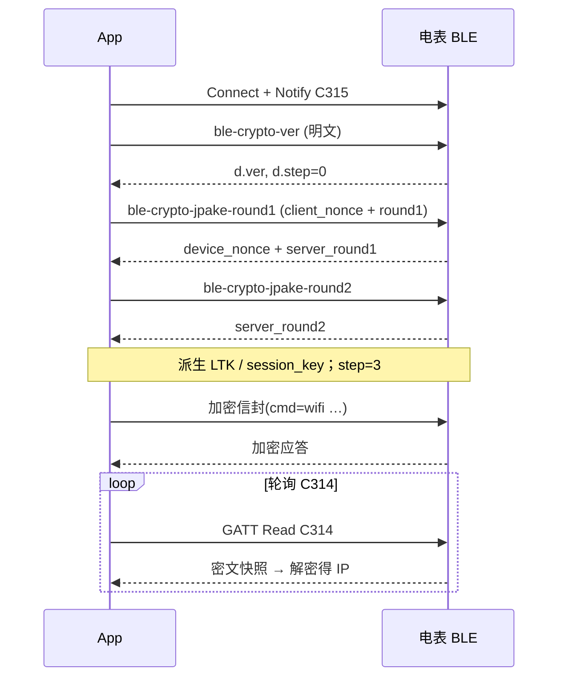
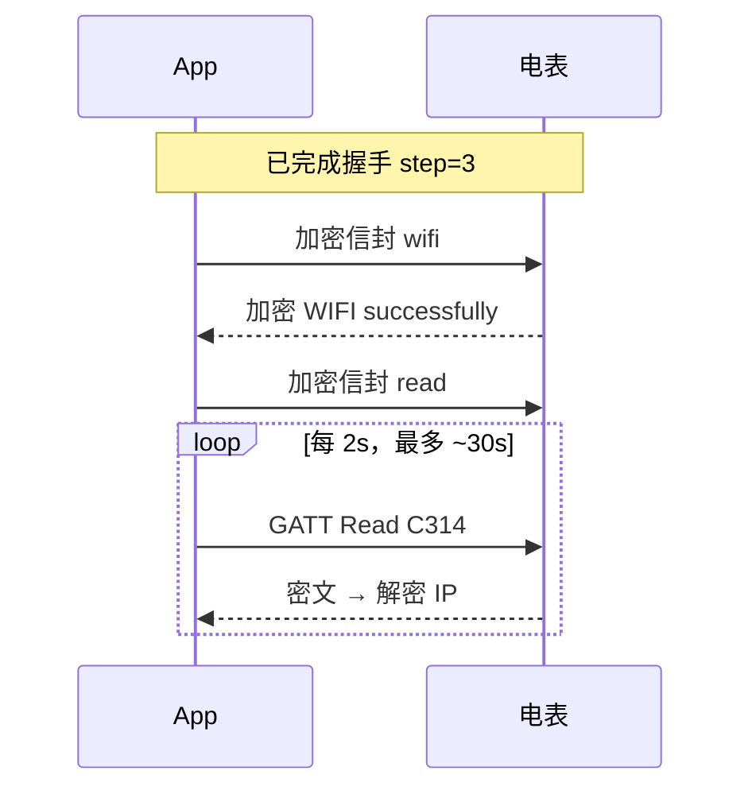

# 电表加密 BLE（Secured / Crypto）接口说明

适用固件：**Lite / Pro**（安全通道，服务 `A003`）　|　文档版本：v1.1　|　日期：2026-10　|　密码学细节对齐 [协议权威参考](crypto-protocol.zh-CN.md)（V2）　|　握手、加密配网、读写特征已用本仓库的 Windows 工具和网页在真机上走通

通过低功耗蓝牙连接电表通讯模组，可以：**建立应用层加密会话**、**把 2.4 GHz Wi-Fi 配进电表**、读电参与联网状态、配置 MQTT / UDP / Modbus、开关局域网通讯功能、触发定位 / 重启 / OTA。

- 安全握手阶段：收发为 **明文 UTF-8 JSON**。  
- 安全通道建立后：业务报文为 **加密信封**（`nonce` / `ct` / `tag`）。  

本文面向系统集成商、DIY 开发者和 AI 编程助手。命令名、字段名、设备 `msg` 保持英文原样。

> **文档分工：** 本页讲加密通道的**传输层**——UUID、握手、密钥派生摘要、加密信封、重连。配网命令、设备命令、读快照字段、业务错误码在 [业务命令参考（明文 / 加密共用）](../ble-common/ble-business-api.zh-CN.md)，解密后的业务 JSON 与明文通道**完全一致**，只维护一份。J-PAKE / ZKP 的二进制布局、广播厂商数据细节在 [协议权威参考](crypto-protocol.zh-CN.md)，**两份文档冲突时以它为准**。

线上 Overview：[SPM/SDM Open Wi-Fi API Overview](https://docs.bituo-technik.com/device-api/spm-sdm-open-wi-fi-api-overview)（BLE Secured 适用于 Lite/Pro）。

---

## 1. 快速开始（5 分钟）

最小闭环：**连接 → 订阅通知 → 安全握手 → 加密配 Wi-Fi → 读 IP 确认**。

| 项 | 值 |
|----|----|
| 广播名 | `<型号>-<序列号>`，如 `SDM01_3PN-10304B0D7760`；按前缀 `SDM` / `SPM` / `SXM` 过滤 |
| 服务 | `0xA003` |
| 写命令 | `0xC313` |
| 读快照 | `0xC314` |
| 通知应答 | `0xC315` |
| PIN | 机身 **8 位数字**（仅 `0-9`），**不是**明文通道的 `1234`。机身二维码下方的 **11 位数字**可由工具换算成 8 位 PIN，见 [4.3](#43-认证材料) |
| SN | 设备序列号（常为广播名 `-` 后 12 位 hex），参与 PBKDF2 / HKDF |
| Wi-Fi | 仅 **2.4 GHz** |

### 1.1 明文 vs 加密（互斥）

| | 明文 BLE（Basic / Basic+） | 加密 BLE（Lite / Pro，本文） |
|--|---------------------------|------------------------------|
| 服务 | `0xA002` | `0xA003` |
| 写 / 读 / 通知 | `C303` / `C304` / `C305` | `C313` / `C314` / `C315` |
| 门禁 | `cmd=pass` + BLE 密码 | EC J-PAKE（PIN + SN） |
| 业务载荷 | 明文 JSON | 建链后加密信封 |

同一固件不会同时暴露两套应用 GATT。扫到 `A002` 请改用 [明文 BLE 接口说明](../ble-plaintext/ble-plaintext-api.zh-CN.md) 与明文工具。

### 1.2 先用工具验证（推荐）

不想先写代码，请先用 [第 10 节](#10-体验工具) 的 **Windows 工具**或 **Chrome / Edge 网页**完成一次完整握手与配网（两者均实现 EC J-PAKE + AES-CCM）。

### 1.3 最小流程（概念伪代码）

```text
1. requestDevice / scan → connect → startNotifications(C315)
2. 明文写 {"cmd":"ble-crypto-ver"} → 读 d.ver、d.step
3. 按 step 分支：
   step==0：PIN+SN+ver 做 PBKDF2 → EC J-PAKE round1/round2 → 派生 LTK / session_key → step=3
   step==2：用已缓存 LTK + ble-crypto-session-nonce 恢复会话 → step=3
   step==1：ble-crypto-reset 后回到 step 0，或断开重连
   step==3：设备在这条连接上已经建过链；客户端有本地会话态就直接发业务，没有就断开重连（见 4.11）
4. 加密发送 {"cmd":"wifi","ssid":"...","pass":"..."}
5. 加密发送 {"cmd":"read"}，再 GATT Read C314（解密后）直到 IP 为 IPv4
```

密钥派生与信封格式见 [第 4 节](#4-gatt--会话--安全握手)。**参考实现**：[`tools/ble-secured/ble_crypto_core.py`](../../tools/ble-secured/ble_crypto_core.py)（Python）与 [`tools/ble-secured/ble_secured_crypto.js`](../../tools/ble-secured/ble_secured_crypto.js)（浏览器 / JS）；两者可互相对照。

---

## 2. 用 AI 写你自己的 App

把**本页全文、[业务命令参考](../ble-common/ble-business-api.zh-CN.md) 全文、[协议权威参考](crypto-protocol.zh-CN.md) 全文**连同下面这段提示词交给 AI。（也可以用仓库里生成好的单文件合集，见 `AGENTS.md`。）

```text
你要实现一个 BLE 客户端，对接下面的"电表加密 BLE 接口说明"（Lite/Pro）、"业务命令参考"和"协议权威参考"。
1. 只使用加密 UUID：A003 / C313 / C314 / C315。禁止使用 A002 / C303 / C304 / C305。
2. 连接后先订阅 C315，再发明文 {"cmd":"ble-crypto-ver"}，按 d.step 分支：
   - step=0：PBKDF2(PIN, salt=SN||ver||"PBKDF2", iter=10000) → EC J-PAKE (secp256r1) round1/round2 → HKDF 得 LTK/session_key；
   - step=2：ble-crypto-session-nonce + 已存储 LTK 恢复 session_key；
   - step=1：ble-crypto-reset 或重连后再来；
   - step=3：设备已在本连接上建链。客户端有本地会话态就继续；没有就断开重连，不要再发 J-PAKE。
3. 建链前握手 JSON 明文收发；建链后业务必须套 AES-128-CCM 信封 {nonce,ct,tag}（tag 8 字节；JSON nonce 是 uint32 计数器，客户端->设备严格递增）。
4. 命令必须串行：写一条 → 等 event 匹配的通知（解密后）→ 再写下一条。禁止并发。
5. 配网用加密后的 {"cmd":"wifi","ssid":"...","pass":"..."}；成功后加密发 {"cmd":"read"}，再轮询 GATT Read C314（解密）的 IP，出现点分十进制才算成功。
6. PIN 仅 8 位数字，来自机身；不要编造现场 PIN。LTK 只在配网成功（STA 关联）后才会在设备侧落盘。
7. 不要发送明文通道的 pass / blepassword / resetauth。
8. 文档里没有的命令和字段一律不要编造；不确定就输出 TODO 并说明原因。算法参数（曲线、迭代次数、info 字符串）一个字都不要改。
先实现：扫描 → 连接 → 订阅 → 握手 → 加密配 Wi-Fi → 轮询 IP。再实现：读电参、model、getFunctionMap、mqttdata。
先用 spec/ble-secured-test-vectors.json 验证你的 PBKDF2 / HKDF / AES-CCM 实现，再去连真机。
```

AI 生成代码后，用 [9.3 验收清单](#93-验收清单) 自测。

---

## 3. 概述与适用范围

### 3.1 你能做什么

1. 发现并连接设备（服务 `A003`）  
2. 完成安全握手或会话恢复  
3. 经加密信封下发 Wi-Fi 名称与密码  
4. 读 IP / 信号 / 电参  
5. 配 MQTT、UDP、Modbus 485 参数，开关局域网通讯，查 / 升级固件  

### 3.2 适用判断

满足下面两点，就按本文对接：

- 广播名前缀为 `SDM` / `SPM` / `SXM`；  
- 能发现 GATT 服务 `A003`。

不要按本文对接：

| 情况 | 说明 |
|------|------|
| 服务是 `A002`，无 `nonce`/`ct`/`tag` 业务信封 | 明文通道，见 [明文 BLE 接口说明](../ble-plaintext/ble-plaintext-api.zh-CN.md) |
| 需要控制继电器 / 通断器 | 本文不含开关控制命令 |
| 设备没有 Wi-Fi | 没有本文的配网路径 |
| 只走 HTTP / MQTT、不经过 BLE | 见对应通道的 API 文档 |

### 3.3 型号与分支差异

| 固件分支 | BLE | TLS 并发（概要） |
|----------|-----|------------------|
| Lite | 加密 | Wi-Fi 侧 MQTT TLS；HTTP/Modbus/WS 无 TLS（见 Overview 矩阵） |
| Pro | 加密 | 最多约 2 路 TLS；有 HTTPS（见 Overview） |

不同型号支持的业务命令不完全一致，不支持时设备返回失败（`unsupported` / `unknow cmd` 等）。**客户端必须按 `ok` / `msg` 处理。** 产品身份以广播名和读快照里的 `TP`、`SN` 为准。

---

## 4. GATT / 会话 / 安全握手

### 4.1 UUID

大小写不敏感。完整 128 位与标准蓝牙基 UUID 组合：

| 角色 | 16 位 | 128 位 |
|------|-------|--------|
| 主服务 | `0xA003` | `0000A003-0000-1000-8000-00805F9B34FB` |
| 写（客户端 → 电表） | `0xC313` | `0000C313-0000-1000-8000-00805F9B34FB` |
| 读（状态快照） | `0xC314` | `0000C314-0000-1000-8000-00805F9B34FB` |
| 通知（电表 → 客户端） | `0xC315` | `0000C315-0000-1000-8000-00805F9B34FB` |

### 4.2 传输规则

- 编码 UTF-8 JSON，不要 BOM。握手阶段：一条命令 = 一次 Write；一条应答 = 一次 Notify。  
- **订阅 `C315` 必须在发第一条命令之前**。  
- **命令必须串行**。轮询 `C314` 不要与写命令交错。  
- 同一时刻通常只支持一个 BLE 连接；已有客户端连着时设备不再广播，新客户端扫不到。  
- **MTU：** Round1 的 Base64 很长，协议支持分片（`client_round1_part` / `fetch_next`，细节见协议权威参考）。业务信封同样受 MTU 限制，一条应答只发一包通知；MTU 停在默认 23 会截断应答。Android 请在连接后 `requestMtu(517)`；Windows（bleak）实测协商到 527；Web Bluetooth 由浏览器协商。  
- 不要使用 `A002` / `C303` / `C304` / `C305`。

### 4.3 认证材料

| 材料 | 规则 |
|------|------|
| `PIN` | 固定 **8** 位数字字符串，仅 `0-9`，**只能从机身获取** |
| `SN` | 设备唯一序列号，参与 salt / info |
| `ver` | 设备 `ble-crypto-ver` 返回的 `d.ver`（字面量，例 `BT_Crypto_V1`） |

**机身二维码下方的 11 位数字：** 它是带校验位的手动配对码（Verhoeff 校验），可以换算成 8 位 PIN。**协议本身只认 8 位 PIN**，换算是客户端的便利功能：本仓库工具的输入框两种都收（11 位会先校验再还原为 8 位）。参考实现：Python `pin_from_manual_pairing_code`（`ble_crypto_core.py`）、JS `pinFromManualPairingCode`（`ble_secured_crypto.js`）。自己的 App 若只让用户输入 8 位 PIN，可以不实现。

### 4.4 协议阶段 `step`

| step | 含义 |
|------|------|
| `0` | 等待 `ble-crypto-jpake-round1` |
| `1` | 等待 `ble-crypto-jpake-round2` |
| `2` | 已具备长期密钥 LTK，等待 `ble-crypto-session-nonce` |
| `3` | 安全通道已建立，可发送加密业务 |

`step=3` 只对**当前这条 GATT 连接**成立，见 [4.11](#411-常见陷阱)。

### 4.5 密钥派生摘要（禁止改参数）

摘自 [协议权威参考](crypto-protocol.zh-CN.md)，集成时必须一致：

1. **PBKDF2-HMAC-SHA256**：输入 PIN（ASCII），`salt = SN || ver || "PBKDF2"`（UTF-8 拼接），迭代 **10000**，输出 32 字节 `s`。  
2. **EC J-PAKE**：曲线 `secp256r1`，哈希 SHA-256，round1/round2 载荷 **Base64**；身份 `"client"` / `"server"`；ZKP 绑定 `s`。  
3. **共享密钥** → `SHA-256(K.x)` → 32 字节 `shared_key`。  
4. **HKDF-SHA256**：  
   - LTK(16)：IKM=`shared_key`，`salt=device_nonce||client_nonce`，`info=SN||ver||"LTK"`  
   - session_key(16)：IKM=`LTK`，同 salt，`info=SN||ver||"session"`  
   - broadcast_key(16)：同 LTK salt，`info=SN||ver||"broadcast"`（广播长包用，见附录 D）  
5. **GATT 业务 CCM**：AES-128-CCM，无 AAD，`tag` **8** 字节。12 字节 CCM nonce = 8 字节 HKDF 基底 + BE32(counter)。基底：  
   - 设备→客户端：`HKDF(salt=∅, IKM=device_nonce||client_nonce, info="ccm-tx-nonce", L=8)`  
   - 客户端→设备：`HKDF(salt=∅, IKM=client_nonce||device_nonce, info="ccm-rx-nonce", L=8)`  

`client_nonce` / `device_nonce`：各 **8** 字节，JSON 中为 **16** 个十六进制字符。

ZKP / Round 二进制布局见 [协议权威参考 §3.4](crypto-protocol.zh-CN.md#34-ec-j-pake)。**禁止自行发明曲线参数或迭代次数。**

**校验你的实现：** [`spec/ble-secured-test-vectors.json`](../../spec/ble-secured-test-vectors.json) 给出固定输入下的 PBKDF2、HKDF、AES-CCM 期望输出，不需要真机就能验证密码学部分。J-PAKE 含随机数，无法给固定输出，请用真机或本仓库工具对照。

### 4.6 首次建链时序



**LTK 落盘**：Round2 成功后内存可用；**须在同一加密会话内配 Wi-Fi 且 STA 关联成功**后才持久化。未落盘则重启后回到需 J-PAKE。

### 4.7 重启后恢复（step=2）

```text
ble-crypto-ver → step=2 → ble-crypto-session-nonce(新 client_nonce)
→ 用已存 LTK 重算 session_key 与 CCM 基底 → 加密业务
```

客户端应安全缓存 LTK（本仓库 Windows 工具写入 `ble_crypto_client_cache.json`，已在 `.gitignore` 中；**不要提交、不要截图外传**）。恢复出厂会清除设备侧 LTK，客户端缓存的 LTK 随之作废，需要重新用 PIN 走 J-PAKE。

### 4.8 加密信封形状

建链后业务统一：

```json
{
  "nonce": 1,
  "ct": "BASE64_CIPHERTEXT",
  "tag": "BASE64_TAG"
}
```

- `nonce`：**uint32 计数器**（不是握手用的 hex nonce 串）。  
- 客户端→设备：每包 `nonce` 必须 **严格大于** 设备当前已接受值，否则 `replay detected`。  
- 设备→客户端：设备侧发送序号从 1 递增。  
- 加密前 / 解密后的业务 JSON 与明文通道完全相同（见 [业务命令参考](../ble-common/ble-business-api.zh-CN.md)），例如：

```json
{"cmd":"wifi","ssid":"OfficeWiFi","pass":"router-password"}
```

```json
{"ok":true,"msg":"WIFI successfully","event":"wifi"}
```

信封本身出错时，设备可能回 `{"ok":false,"event":"secure",...}`（明文，不是密文），客户端应识别并提示重新握手。

### 4.9 明文握手命令一览

| cmd | 要点 |
|-----|------|
| `ble-crypto-ver` | 查 `ver` / `step` |
| `ble-crypto-reset` | 仅 step 0/1；不清除已落盘 LTK |
| `ble-crypto-jpake-round1` | `client_nonce` + `client_round1`；可分片 |
| `ble-crypto-jpake-round2` | `client_round2` |
| `ble-crypto-session-nonce` | 仅 step=2 |

成功应答通用字段：`ok`、`msg`、`event`、可选 `d`。

### 4.10 断开与重连

`restart` / `reset` / `mqtr` 成功后 GATT 会断。建议：

```text
等 4 秒 → 扫同名设备 → 连接 → 订阅 C315 → ble-crypto-ver
→ step=2 则 session-nonce；否则重新 J-PAKE（需 PIN）
→ 最多约 12 次重试
```

`wifi` 成功后 BLE 通常保持连接，便于读 IP。**Wi-Fi 连上之后，设备默认会收起应用 GATT 和广播里的服务 UUID**（降低暴露面）；若希望配网后仍能用 BLE，配网时在 `wifi` 命令里带 `enableble:true`，见 [业务命令参考 §2.2](../ble-common/ble-business-api.zh-CN.md#22-下发-ssid-与密码) 和 [协议权威参考 §9.4](crypto-protocol.zh-CN.md#94-wifi-已连接时的-gatt-与广播-uuid)。

### 4.11 常见陷阱

| 现象 | 原因与处理 |
|------|-----------|
| 一连上就读到 `step=3`，但本地没有会话态 | 这条 GATT 连接上之前已经握过手（比如重复点了"握手"，或客户端崩溃重启而设备没断）。**不要再发 J-PAKE**：断开 GATT，重新连接，设备会回到 `step=0` / `step=2` |
| `step=3` 时又发 `ble-crypto-reset` | 无效。`ble-crypto-reset` 只在 step 0/1 有效 |
| `replay detected` | 客户端->设备的 `nonce` 没有严格递增。每次新会话计数器从 1 开始，同一会话内不要回退、不要重复 |
| `decrypt failed` | 密钥、nonce 基底方向或计数器不对：设备->客户端用 `ccm-tx-nonce` 基底，客户端->设备用 `ccm-rx-nonce` 基底，别搞反 |
| 握手成功但配网后重启回到 step=0 | Wi-Fi 没有关联成功，LTK 没落盘，属预期；需要重新 J-PAKE |
| 看不到设备 | 设备已被另一个客户端连着（含手机 App / 另一个浏览器页）；Wi-Fi 已连接且未开 `enableble` 时设备也不再广播应用 UUID |

---

## 5. Wi-Fi 配网（加密通道）

电表出厂通常还没有路由器账号。手机 / 工具先完成 **安全握手**，再经 **加密信封** 下发 2.4 GHz SSID 与路由器密码。

### 5.1 用户视角

1. 打开蓝牙，靠近电表。  
2. 列表里出现 `型号-序列号`，连接并输入 **配网码**（机身二维码下 11 位，或 8 位 PIN）。  
3. 完成安全握手（工具一键）。  
4. 可选：扫描附近 Wi-Fi。  
5. 输入**路由器密码**（不是 PIN），发送到电表。  
6. 读状态，`IP` 变成 `192.168.x.x` 即成功；此时 LTK 才应落盘。

### 5.2 协议步骤

**A. 握手** 见 [4.6](#46-首次建链时序) / [4.7](#47-重启后恢复step2)。

**B～D. 扫热点、下发 SSID / 密码、确认上网、界面文案**：业务层命令与明文通道完全相同，见 [业务命令参考第 2 节](../ble-common/ble-business-api.zh-CN.md#2-wi-fi-配网业务命令)。区别只有：每条 JSON 先加密成信封再写 `C313`；读 `C314` 后若是信封要先解密。



---

## 6. 命令参考

建链后（**step=3 且客户端持有 session_key**）发送加密信封。`event` 默认等于 `cmd`。

### 6.1 业务命令

全部业务命令（Wi-Fi、`restart` / `location` / `zero` / `reset` / `deviceName`、`model` / `getFunctionMap` / `mqttdata` / `udpdata`、通讯开关、MQTT、Modbus 485、UDP、OTA）见 [业务命令参考第 3 节](../ble-common/ble-business-api.zh-CN.md#3-命令参考)，命令索引见 [第 4 节](../ble-common/ble-business-api.zh-CN.md#4-命令索引给-ai-扫)。

加密通道的差别：

- **不要**发 `pass` / `blepassword` / `resetauth`（它们属于明文通道的门禁）。  
- `read` 写成 `{"cmd":"read"}`，不需要 `continue`。  
- `restart` / `reset` / `mqtr` 成功后 GATT 会断，按 [4.10](#410-断开与重连) 重连并恢复会话。  
- OTA 类命令超时宜 ≥ 25 s。

### 6.2 命令索引（通道专有部分）

握手：`ble-crypto-ver`, `ble-crypto-reset`, `ble-crypto-jpake-round1`, `ble-crypto-jpake-round2`, `ble-crypto-session-nonce`（见 [4.9](#49-明文握手命令一览)）

业务命令见 [公共命令索引](../ble-common/ble-business-api.zh-CN.md#4-命令索引给-ai-扫)。不要使用任何文档里没有的命令名。

---

## 7. 读特征 C314：IP 与电参

电参与 IP 快照走 **`C314` 的 GATT Read**。建链后读回内容可能是加密信封，客户端须先判断：JSON 里有 `nonce` + `ct` + `tag` 就解密，再按 [业务命令参考第 5 节](../ble-common/ble-business-api.zh-CN.md#5-读快照ip-与电参) 解析字段（`IP` / `RSSI` / `FW` / `SN` / `TP` 与电参键、单位）。

先发加密的 `{"cmd":"read"}`，应答 `ready` 后再 Read。

---

## 8. 错误码

### 8.1 握手 / 安全层（常见 `msg`）

以设备英文 `msg` 为准（摘自 [协议权威参考 §10](crypto-protocol.zh-CN.md#10-失败条件)）：

| `msg` | 含义 |
|-------|------|
| `connection key must be 8 digits` | PIN 不是 8 位数字 |
| `invalid step` | 当前 step 不允许该握手命令 |
| `invalid round1` / `invalid round2` | 载荷非法 |
| `round1 verify failed` / `round2 verify failed` | ZKP / PIN 不一致等 |
| `replay detected` | 业务信封计数器未严格增大 |
| `decrypt failed` | CCM 认证解密失败 |
| `device locked` / `version required` | 见协议权威参考的失败条件 |

固件对信封错误可能使用 `event":"secure"` 且 `ok=false`——客户端应识别并提示重新握手。

### 8.2 业务错误码

与明文通道同一张表，见 [业务命令参考第 6 节](../ble-common/ble-business-api.zh-CN.md#6-业务错误码)，低频码见其附录 A。

### 8.3 传输类

| code | `msg` | 处理 |
|------|-------|------|
| 1050 | payload too large | 写入过长：缩短 JSON，或提高 MTU |

---

## 9. 开发清单

### 9.1 硬约束

1. 只用 `A003 / C313 / C314 / C315`。  
2. 先订阅 `C315`；握手明文，业务加密。  
3. PBKDF2 迭代 10000；PIN 8 位；曲线 secp256r1。  
4. 命令串行；解密后用 `event` 匹配。  
5. 配网闭环：握手 → 加密 `wifi` → 读 IP；理解 LTK 落盘条件。  
6. 不要编造文档没有的字段；不要打印完整会话密钥到默认日志。  
7. `step=3` 但没有本地会话态时断开重连，不要再发 J-PAKE。  

### 9.2 建议模块

`scan` → `connect` + notify → `handshake`（ver / jpake 或 session-nonce）→ `secureRpc`（加密封装 + 串行）→ `provisionWifi` → `readSnapshot` → `reconnect`。

### 9.3 验收清单

- [ ] 用 `spec/ble-secured-test-vectors.json` 验证了 PBKDF2 / HKDF / AES-CCM  
- [ ] 能列出附近电表（前缀过滤）  
- [ ] 连接后已订阅 `C315`  
- [ ] `ble-crypto-ver` 得到 `ver` / `step`  
- [ ] PIN 错误时 Round 验证失败，不会静默当成功  
- [ ] 握手后加密 `wifi`，解密应答可见 `WIFI successfully`  
- [ ] `C314` 解密后 `IP` 变为 IPv4  
- [ ] 命令串行；未建链发业务能识别失败  
- [ ] `step=3` 但无本地会话时能提示断开重连，而不是反复握手  
- [ ] 重启后 step=2 可用缓存 LTK 恢复（若曾配网成功）  
- [ ] UI / 文档不会误用 `A002`  

### 9.4 平台提示

| 平台 | 提示 |
|------|------|
| Android | `requestMtu(517)`；一次一个 GATT |
| iOS | Core Bluetooth；Web Bluetooth 不可用（Safari 不支持） |
| Windows | 用 `tools/ble-secured/ble_secured_gui.py` + bleak |
| 浏览器 | Chrome / Edge（桌面、Android）Web Bluetooth，须 HTTPS 或 localhost。**`watchAdvertisements`（听业务广播）在 Windows 上的 Chrome 通常不可用**，要听广播请用 Windows 工具 |

---

## 10. 体验工具

协议与本文一致。详见 [`tools/README.md`](../../tools/README.md)。

**托管地址：** 官方托管的网页地址与 Windows 工具下载地址以发布渠道为准，发布后补充到这里。

### 10.1 Windows 图形工具（完整握手）

```bat
cd tools\ble-secured
py -3 -m pip install -r requirements.txt
py -3 ble_secured_gui.py
```

扫描 / 连接 / **安全握手** / Wi-Fi / 一键命令 / Modbus 485（含校验位 / 停止位）/ 自定义 JSON（明文业务对象，工具自动加密封装）/ 业务广播监听 / 中英切换 / 自动重连。

### 10.2 Chrome / Edge 网页

`web-ble-secured-console.html`：与 Windows 工具同协议——完整 J-PAKE、加密配网、一键命令、Modbus 485、自定义 JSON、读电参、GATT 断开后自动重连并恢复会话。

两种交付形式（内容同一份源码）：

| 文件 | 用途 |
|------|------|
| `web-ble-secured-console.html` | 开发 / AI 改功能用。分文件，须本地 HTTP（`py -3 -m http.server 8765`），依赖同目录 `vendor/` 离线密码学库（无需 CDN） |
| `web-ble-secured-console.offline.html` | 发给客户 / 放对象存储用。**单个文件**（约 105 KB），所有脚本内联；放到任意 HTTPS 静态托管即可用手机 Chrome 打开。由 `bundle_offline_html.py` 生成，不要手改 |

### 10.3 怎么选

| 环境 | 用哪个 |
|------|--------|
| 真机配网 / 写 App 前验证 | Windows 工具或网页均可 |
| 仅有 Chrome、无 Python | 网页（单文件版） |
| 听业务广播 | Windows 工具 |
| iOS / Android App | 按本文实现原生栈 |

---

## 11. 安全说明

- PIN 来自机身，装机后按产品策略妥善保管；不要把示例 PIN 写进现场配置。  
- 握手前 JSON 明文可被近场抓取；建链后业务载荷为 CCM 密文，但仍依赖物理接近与 PIN 保密。  
- LTK / session_key / broadcast_key 属于密钥材料：默认日志不要打印完整值；客户端缓存文件不要提交到仓库。  
- Wi-Fi 密码在加密信封内下发；链路外安全仍依赖 BLE 距离与设备保管。  
- 需要远程保密时，配网成功后走 HTTPS / MQTTS 等联网通道。

---

## 附录

附录 A（低频错误码）、B（`functionMap` 位）、C（`model` 短键）两个通道共用，见 [业务命令参考](../ble-common/ble-business-api.zh-CN.md#附录-a-低频错误码)。

## 附录 D 广播厂商数据（可选）

加密固件可在广播中带短包（5 字节，step=0）或长包（26 字节，AES-128-CCM，tag=4，密钥为 broadcast_key）。GATT 业务信封与广播 CCM **参数不同**。长包解密后是 15 字节明文（电压、电流、功率、电能等定点二进制），字段布局见 [协议权威参考第 9 节](crypto-protocol.zh-CN.md#9-ble-广播厂商数据动态广播)。集成方若只需配网与读写特征，可暂不实现广播解密；需要时参考 Windows 工具的"业务广播"页。
